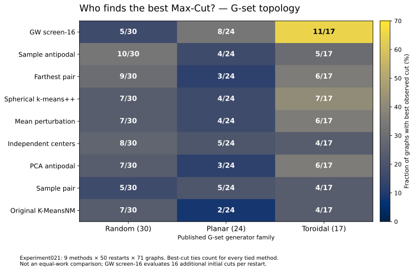
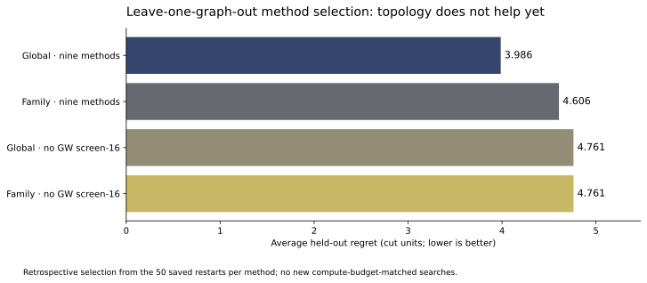
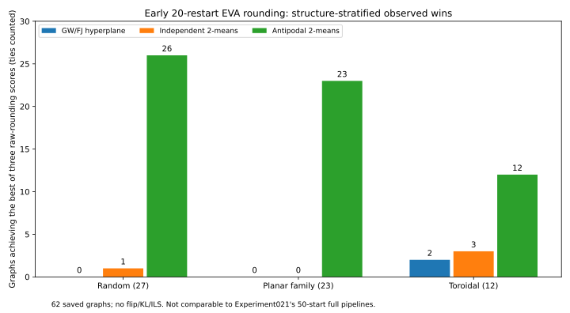
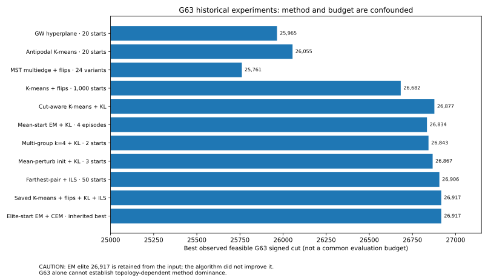

# Experiment022 — Graph topology and initializer performance, retrospective analysis

**Status (29 October 2026):** reproducible **retrospective** exploration of the already completed Experiment021 Max-Cut (`k=2`) data. No new EVA factor, SDP solve, rounding, or local-search run was performed for this study. Initial results were computed directly from the committed 71 × 9 `per_instance_methods.csv` and a published G-set topology classification. The new Python analysis and synthetic tests were locally checked; full extraction of the original 71 graphs' higher-order structural features is provided as a command, **not claimed as run**.

## Research question

Does graph structure predict which of the **nine fixed Experiment021 initializers** reaches (a) the best observed signed Max-Cut across 50 restarts, or (b) the highest mean final score after the same four-stage Round → Flip → generalized KL → ILS pipeline?

Two distinct targets must not be conflated: a method may win more graphs' **best-of-50** contests, but be inferior in **mean-of-50**. Furthermore, `gw-screen16` spends **16 additional original-graph starting-cut evaluations per restart** and `pca-antipodal` has preprocessing overhead. These experiments compare observed cut quality, **not equal wall-clock compute budgets**.

## Sources, labels, and audit

- Primary numerical data: `results/gset/experiment021-complete-71-gset/statistics/per_instance_methods.csv` on the original graph and immutable EVA factor for each of 71 graphs; 50 matched restart IDs per initializer and fixed downstream seed streams.
- Secondary metadata: [OpenIsing's G-set README](https://github.com/KULeuven-MICAS/openising/blob/main/ising/benchmarks/G/README.md), which labels the 71 canonical graphs **random** (30), **planar** (24), and **toroidal** (17).
- **Important metadata correction:** the secondary table categorizes G48/G49/G50's weights as `+1,-1`, but direct inspection of the *canonical original* `data/G48.txt`, `G49.txt`, and `G50.txt` finds all 6,000 weights equal to **+1** on each graph. The research code records their true **positive-only** edge class, distinct from topology. G48 and G49's unweighted structure is also noted in Rodríguez-Fernández et al. (2020), page 8.
- **Visualization caution:** a circular-looking network drawing is not by itself evidence of a toroidal graph, or evidence that the G-set supplied spatial vertex coordinates. Graph drawings depend on layout; here the classification is based on the benchmark's graph-generation metadata, and structural features come from the undirected original graph.
- Literature reference cut values and method outputs are distinct; do **not** copy a published best-known cut into the empirical score columns.

## Exact top-cut comparisons (ties counted for every tied initializer)

| Family | Graphs | Most frequent best-cut initializer | Number of graphs it ties/reaches global best | Fractional wins (ties split equally) |
| --- | ---: | --- | ---: | ---: |
| random | 30 | `sample-antipodal` | **10** | **5.712** |
| planar | 24 | `gw-screen16` | **8** | **5.700** |
| toroidal | 17 | `gw-screen16` | **11** | **5.250** |

For `gw-screen16` specifically: **5/30 random**, **8/24 planar**, **11/17 toroidal** have a best-cut tie or sole win. However **G48/G49/G50** have *all nine initializers tied* in best-of-50, so their inclusion inflates the 11/17: among the **14 toroidal graphs with at least two different method maxima**, screen-16 wins or ties on **8/14**. Among signed-weight non-toroidal graphs, only **2/22** show a screen-16 best-cut tie or win. A two-sided Fisher exact calculation for these selected subsets (8/14 vs 2/22) is **p≈0.00545**, *exploratory only*: families share generators, many tests and subgroups were inspected, restarts are correlated, and additional cut evaluations are not budget-matched. This is **not a controlled causal effect** or population-level significance claim.

## Mean final-cut differences versus original paired K-MeansNM

Mean differences = unweighted mean of each graph's method mean over 50 restarts **minus the same graph's paired-method mean**. Raw cuts from different graphs are never pooled as independent restarts.

| Family | GW screen-16 | Sample antipodal | Mean perturbation | Original paired |
| --- | ---: | ---: | ---: | ---: |
| random (30) | **+0.115** | −0.374 | −0.615 | 0 |
| planar (24) | **−0.399** | −1.196 | −0.671 | 0 |
| toroidal (17) | **+0.605** | −0.518 | **+0.452** | 0 |

These are **original signed cut units**, generally tiny relative to the achieved cuts and possibly sensitive to graph composition. A high win frequency does not imply a positive mean effect on a typical run.

## Does a structural method selector generalize? First out-of-graph test

We tested a **nested train/test selection** across the 71 existing graphs: for each held-out graph, select an initializer using *only the other 70 graphs*. The training target is mean graph-normalized **best-of-50 improvement over paired** (`(best_method − best_paired)/abs(best_paired)`). Two selectors: `global`, which pools the 70 training graphs, versus `family`, which pools only the held-out graph's family in training. The held-out cut is never used to choose its method. Results remain retrospective and **not compute-budget-matched**.

| Candidate methods | Selector | Average held-out cut gain vs paired | Mean relative gain vs paired | Mean regret vs oracle best-of-nine |
| --- | --- | ---: | ---: | ---: |
| all nine | global | **+0.732** | +0.0143% | 3.986 |
| all nine | family | **+0.113** | +0.0010% | 4.606 |
| excluding GW screen-16 | global | −0.690 | −0.0227% | 4.761 |
| excluding GW screen-16 | family | −0.690 | −0.0217% | 4.761 |

**Conclusion:** the available categorical topology label has a strong descriptive association with best-cut wins, **but the family-specific selection policy did not improve held-out results** relative to a globally trained policy in this simple LOOCV test. The one-family policy also has fewer training graphs and is affected by signed-weight class and graph size. Neither policy should be deployed as an automatic selector based on these data alone.

## Reconstructed structural examples from the original graphs

The following features were computed directly from canonical, one-based `data/G*.txt` edge lists (not a visualization):

| Graph | Labeled family | Vertices | Edges | Mean degree | Degree CV | Exact triangles | Transitivity | Negative edge fraction |
| --- | --- | ---: | ---: | ---: | ---: | ---: | ---: | ---: |
| G1 | random | 800 | 19,176 | 47.940 | 0.1318 | 18,093 | 0.0593 | 0 |
| G14 | planar benchmark family | 800 | 4,694 | 11.735 | 0.9830 | 5,302 | 0.1535 | 0 |
| G11 | toroidal | 800 | 1,600 | 4 | 0 | 0 | 0 | 0.4894 |
| G48 | toroidal | 3,000 | 6,000 | 4 | 0 | 0 | 0 | 0 |

**Planarity label caveat:** G14 is from the benchmark's `planar`/*almost-planar* **generator family**, not a mathematically planar simple graph: `m=4,694 > 3n−6=2,394` for `n=800`. The G-set paper describes these graphs as *almost planar*. Avoid inferring a strict genus/topological embedding from the generator-family name.

## Visual evidence





The figures are reproducible from the saved Experiment022 CSV results using:

```powershell
python scripts/plot_experiment022.py
```

This requires Matplotlib for plotting only. Graph-family percentages include **all best-cut ties**, so interpret them together with the fractional-win metric and the noninformative G48–G50 graphs.

## Graph-level explanatory variables to evaluate next

`src/maxkcut/graph_structure_methods.py` reads the canonical original `data/G*.txt` and can save:

- graph size `n`, edges `m`, edge density / average degree;
- degree coefficient of variation;
- fraction of negative original edge weights;
- number of connected components and largest component fraction;
- exact undirected triangle count and global clustering coefficient (`3 × triangles / wedges`);
- cyclomatic number `m−n+c` and normalized cycle rank.

These quantities describe the **graph itself**; they do not depend on visualization coordinates or embedder seed.

**A second, distinct geometry is the EVA vector cloud**: each vertex has a unit vector `y_i` in the saved factor `Y∈R^{n×p}`. A 2D PCA/t-SNE/UMAP scatter can create circular-looking patterns that are not actual spatial input coordinates; it must not substitute for intrinsic high-dimensional measurements. Relevant proposed features include anisotropy `||mean_i y_i||`, normalized Gram-spectrum effective rank, edge versus nonedge cosine distributions, spherical cluster separability, and antipodal pairing concentration. These are **not yet measured** for all 71 graphs. Preserve each factor's SHA256 when that extension is implemented.

For sparse toroidal/grid-like graphs, **four-cycles and signed-cycle frustration** may be more diagnostic than triangles alone: e.g. G11 and G48 are triangle-free with constant degree four. Count or sample short even cycles and record the sign product around them in a future prespecified extension. A separate future extension could study unit-vector EVA factor geometry (effective rank, concentration, edge cosine distribution). That extension must preserve original factor SHA and distinguish low-rank nonconvex EVA from full convex SDP solutions.

### Reproduce without optimization

From repo root in the existing Conda environment:

```powershell
python -m pytest tests/test_graph_structure_methods.py -q
python -m maxkcut.graph_structure_methods --skip-features
python -m maxkcut.graph_structure_methods
```

The first analysis command reproduces family comparisons and LOOCV directly from the previous Experiment021 CSV, without reading all original graph edges; the second adds canonical graph-structure features. Outputs are under `results/gset/experiment022-graph-structure-methods/`. The four retrospective statistics files and two vector graphics are already committed to this branch. The full 71-graph \`graph_features.csv\` will be generated only when the feature-extraction command is executed in a complete repository checkout; no expensive workflows are necessary. Synthetic tests do not require EVA, GPUs or saved factors.

## Extension: include historical GW, MST, EM, cut-aware and multigroup methods

This section expands the *catalogue of methods*, but **not the statistical sample size for methods that were tested only on G63**. It is an audit of already committed numerically verified summaries, not a new optimization. The exact ingestion logic is in `src/maxkcut/historical_structure_comparison.py`, and the machine-readable tables in `results/gset/experiment022-graph-structure-methods/historical_*.csv`.

### Comparison strata and coverage

| Stratum | Coverage | Methods and experimental protocol | Legitimate interpretation |
| --- | --- | --- | --- |
| A — Final full pipeline | **71 graphs** | Original nine Experiment021 initializers; **50** restarts × Round → Flip → generalized KL → ILS | Topological associations among these nine, but GW-screen16 spends 16 extra initial-cut evaluations |
| B — Initial *raw* rounding | **62 graphs** | EVA GW/FJ, KMeans2N, antipodal KMeansNM, **20** rounding starts per method | Structural associations at the **rounding-only** stage, not comparable with full ILS final cuts |
| C — Historical specialized algorithms | **G63 only** | MST, soft EM/CEM/Gibbs, cut-aware/threshold rounding, multigroup coarsening, KL/ILS grids, 1000-flip starts | Method/parameter feasibility and historic best cuts **on one planar-family instance**, not extrapolation to random/toroidal graphs |
| D — Missing consolidated summary | **No verified summary** for 005, 006, 010, 011, 015 at documented paths | Direct single-edge MST, central-edge MST, original KL/Tabu, elite search, direct hyperplane variants | Do not invent scores or infer broad graph coverage; other archives may exist and must be audited separately |

**Coverage is not 71 for the historical raw baselines:** 59 verified Experiment002 graphs G1–G59, 2 verified Experiment003 graphs G77 and G81, plus the G63 raw rounders preserved by Experiment008. The 12 pending Experiment002 slots are not counted. G60/G61/G62 have no archived matching GW raw rounder in this consolidated comparison, even though their EVA factors and nine *other* initializers were completed in Experiment021. Each older raw score is a **best of 20**, not a matched full-pipeline best of 50.

### Raw-rounding winners by original G-set generator family (62 graphs)

| Family | Graphs | Antipodal K-MeansNM best/tie | Independent K-Means2N best/tie | GW/FJ best/tie | Mean relative gain of K-MeansNM vs GW/FJ best-of-20 |
| --- | ---: | ---: | ---: | ---: | ---: |
| Random | 27 | **26** | 1 | 0 | **+2.0321%** |
| Planar-family | 23 | **23** | 0 | 0 | **+1.7226%** |
| Toroidal | 12 | **12** | 3 | 2 | **+1.0185%** |
| **Total** | **62** | **61** | **4** | **2** | — |

These **best-of-20 gains** are the unweighted average of per-graph `(best_KMeansNM−best_GW)/|best_GW|`; they do not establish an algorithmic approximation factor, equal-time superiority, or an effect of topology beyond the benchmark corpus. Ties count for every winning method. Different families have different size/sign distributions.

### G63 historical pilots and algorithms (illustrative, NOT common budgets)

| Archived stage/algorithm | Best recorded original signed G63 cut | What the maximum actually represents |
| --- | ---: | --- |
| Experiment008 — GW/FJ, no refinement | 25,965 | Best of 20 hyperplane roundings |
| Experiment008 — antipodal K-MeansNM, no refinement | 26,055 | Best of 20 spherical 2-means roundings |
| Experiment008 — K-MeansNM + positive flips | 26,682 | Best of **1,000** starts; not comparable to 20 raw restarts |
| Experiment009 — exact full-vector MST, multi-edge cuts + vertex flips | 25,761 | Best across 3 embedding distances × 8 cuts of geometric MST edges (`q` values); post-vertex-flip |
| Experiment012 — cut-aware K-means + KL | 26,877 | Best across 200 source starts; compared with same-experiment ordinary KL control reaching 26,886 |
| Experiment013 — cut-aware K-means + KL + ILS | 26,909 | Best across configurations; distinct postprocessing and search budgets |
| **Experiment013 — saved K-MeansNM-Flips + KL + ILS** | **26,917** | Historical best archived feasible cut; selected across a grid |
| Experiment016 — EM/CEM/Gibbs with **elite** initialization | 26,917 | **Retained a pre-existing 26,917 source**; all 16 elite episodes had **zero strictly positive gain over their own source** |
| Experiment016 — mean-init EM + KL or EM + CEM + KL | 26,834 | Four episodes per method; KL yields a gain over mean-init source, but not over historical record |
| Experiment017 — multigroup `k=4` + binary merge + KL | 26,843 | Tiny **two-start** pilot; `k=2` pilot best 26,859 |
| Experiment018 — altered-initializer `mean-perturb` + KL | 26,867 | Three-start KL-only pilot |
| Experiment019/021 — farthest-pair + full Round/Flip/KL/ILS | 26,906 | Best from 50 restarts among the nine-method Experiment019 G63 comparison |

**MST provenance:** Experiment009's `q=1` records also preserve the original single-longest-MST-edge pre-refinement cut for each of L1/L2/L∞. The separate Experiment005 and Experiment006 consolidated result files were not located at their documented paths; their unverified scores are not silently reconstructed or treated as cross-graph data. Exact all-pairs MST scales as `O(n²p)` and cannot be assumed cheap on the largest graphs.

**EM provenance and source leakage:** EM elite variants explicitly load archived elite partitions. In all eight EM variant categories (four algorithms × two starts) the source scores are reported separately from EM soft scores and final hard partitions. The `26917` elite tie is **not** a new EM optimum: all elite episodes' `final_cut - source_cut ≤ 0`. Only mean-start methods with KL record gains over their *own* source in the small pilot. These observations cannot justify an EM-vs-MST or EM-vs-K-Means general ranking.

### Historical-method figures





The figures are generated directly from the archived retrospective tables, without rerunning a graph solver:

```powershell
python scripts/plot_experiment022_historical.py
```

Figure labels emphasize that all G63 methods use different stages/budgets and the elite-EM 26,917 is **inherited**, not a newly found cut.

### Reproduce the historic retrospective audit, no optimization required

```powershell
python -m pytest tests/test_historical_structure_comparison.py -q
python -m maxkcut.historical_structure_comparison
```

The script requires the specific archived CSVs from Experiments002, 003, 008, 009, 012, 013, 016, 017, 018, and 019. It fails on missing/duplicated expected raw-rounding graphs and incorrect G63-only inputs. It writes:

- `historical_raw_rounding_by_graph.csv` — 186 graph × raw method records, with graph family, signed class, individual best cuts, and unrefined-stage marker.
- `historical_raw_rounding_by_family.csv` — nine family × method descriptive summaries.
- `historical_g63_methods.csv` — 55 explicitly named historic method/protocol variants with `records`, `configurations`, `retained_elite_source`, and method-specific score stages.
- `historical_method_coverage.csv` — missing and available source summaries (15 experiment IDs), **not** a claim that all archives in all historical branches were exhausted.
- `historical_report.json` — coverage and source Git blob SHA identities and risk notes; the Python regeneration adds input-file SHA256 provenance.

**Next independent prospective experiment (Experiment023):** evaluate MST / multigroup / EM / direct hyperplane on more graph families using a predeclared **equal computational budget**, shared per-graph EVA factors and signed objectives, and risk-limited staged preflights (especially `O(n²p)` exact MST and potentially expensive EM populations). Save *raw, refined and best-visited cuts separately*, as well as any elite source, number of graph evaluations, wall time, factor hashes, and failed/timeout cases. Only then can a topology-aware choice among **all** algorithms be evaluated honestly.

## Research limits and next hypotheses

**Hypothesis:** toroidal sparse signed graphs might favor searching several initial hyperplanes because geometry leads to different near-best partitions; this is not established by present evidence. Test it using graph-level normalized outcomes with covariates for `n`, signed fraction, degree variability, exact clustering and cycle rank; use leave-one-generator-family/block-out validation to handle correlation between G-set graph siblings. Count tied cuts fairly, evaluate method costs, and pre-register candidate models/primary endpoints before looking at final scores.

**Crucial next experiment (independent):** compare `gw-screen16` and structured alternatives with the original method under a **matched total starting-cut evaluation and wall-clock budget** on genuinely new graph instances, to separate genuine rounding benefits from additional attempts. This should be recorded under a new sequential experiment ID, without overwriting Experiment021/022.