<!-- _class: cover -->

# From K-Means Initialization to Topology-Aware Max-Cut

### Complete research journey · methods, experiments, evidence and next tests

**SDP-inspired vector factors · spherical clustering · local search · G-set**

Experiments 001–023 · 29 October 2026

**Prepared for Professor Ángel E. Rodríguez Fernández**

---

## Verified result at a glance — Experiment021

| Scope | Verified result |
|---|---:|
| Canonical G-set graphs | **71 / 71** |
| Initialization families | **9** |
| Matched restarts per graph and method | **50** |
| Fully archived Max-Cut searches | **31,950** |
| Missing factors / incomplete graphs | **0 / 0** |
| Graphs where best-of-nine beats best-of-control | **58 / 71** |

**Important:** these are feasible **binary Max-Cut** results, **not** certified global optima or a general Max-\(k\)-Cut result for \(k>2\).

Source: [Experiment021 report](https://github.com/heri-espino/maxkcut/blob/main/results/gset/experiment021-complete-71-gset/statistics/report.json).

**This counts Experiment021 only; do not add 1,207 scheduled Experiment023 cells to completed searches.**

---

## Research map: the verified experimental backbone


One graph, one immutable vector factor, multiple comparable rounding strategies, exact re-scoring and archived outputs.

---

<!-- _class: chapter -->

# 1. What problem did we solve?

From a discrete graph partition to a geometric representation.

---

## Formal objective: signed Max-Cut

For an undirected graph \(G=(V,E,w)\), choose binary labels \(c_i\in\{0,1\}\):

\[
\max_{c\in\{0,1\}^{|V|}} C(c),\qquad
C(c)=\sum_{\{i,j\}\in E}w_{ij}\,\mathbf 1[c_i\ne c_j].
\]

- **Positive** \(w_{ij}\): rewards placing endpoints on opposite sides.
- **Negative** \(w_{ij}\): penalizes separating the endpoints.
- All reported cut scores use the **original signed weights**.

The clustering objective is **not** the cut objective: it proposes a partition that must subsequently be evaluated on the graph.

---

## Classical SDP relaxation (the theoretical reference)

Let \(L=D-W\) and \(X=VV^\top\) be a Gram matrix. For general \(k\ge2\):

\[
\max_{X\succeq0,\,X_{ii}=1}\frac{k-1}{2k}\operatorname{Tr}(LX),
\qquad X_{ij}\ge-\frac{1}{k-1}\quad(k>2).
\]

At \(k=2\), the pairwise lower bound is redundant. Factorization represents each vertex \(i\) by a unit vector \(v_i\).

**Crucial distinction:** the large-scale campaign used **rank-restricted nonconvex EVA factors**; these are not proven solutions or certified bounds for the full convex SDP.

Source: repository `AGENTS.md`, `RESEARCH_HANDOFF.md` and Rodríguez Fernández (2021, Chapters 6–7).

---

## Goemans–Williamson: random hyperplane rounding

Draw \(r\sim N(0,I_p)\) and set

\[
c_i=\mathbf 1[v_i^\top r<0].
\]

The hyperplane \(v^\top r=0\) separates embedded vertices into two sides.

**The starting question:** why choose an arbitrary hyperplane if the vector embedding already contains structure from an optimization problem?

- Replace the initial two-way split with **spherical clustering**.
- Keep the original graph cut as the evaluation metric.
- Preserve the GW-equivalent starting cut in the original K-MeansNM control.

Source: Rodríguez-Fernández et al. (2020), Sections 1–3.

---

## How spherical K-means enters Max-Cut rounding

**Original K-MeansNM** initializes two unit centroids as \(u\) and \(-u\). Its first assignment is the GW hyperplane partition.

Then alternate:

1. Assign each \(v_i\) to the centroid with maximum dot product.
2. Normalize each cluster's mean to update its centroid.
3. Keep the **best original-graph cut observed along the trajectory**.

Geometric distortion can decrease without the cut increasing at every step. This is why evaluating **intermediate** iterates matters.

Source: Rodríguez-Fernández et al. (2020), Eq. (4), Lemma 1 and Section 3.1.

---

## Three foundations from the literature

| Work | What it contributed to our design |
|---|---|
| Rodríguez Fernández (2021), thesis | Max-Cut / Max-\(k\)-Cut, SDP geometry, fitness landscapes, clustering rounding |
| Rodríguez-Fernández et al. (2020) | K-MeansNM, K-Means2N and comparison with GW on G-set |
| Felzenszwalb, Klivans & Paul (2022) | Convex geometry of the \(k\)-way elliptope and iterative fixed-point rounding |

The 2022 fixed-point method is **related prior art**, not a claimed component of our Experiment021 implementation.

Sources: project PDFs and [research handoff](https://github.com/heri-espino/maxkcut/blob/experiment021-complete-71-gset/RESEARCH_HANDOFF.md).

---

<!-- _class: chapter -->

# 2. How the research evolved

Prototypes, failed hypotheses, stronger refiners and a controlled comparison.

---

<!-- _class: compact -->

## Experimental chronology: from groundwork to a stable pipeline

| Experiments | Research direction | What we learned |
|---|---|---|
| 001–003 | I/O, full SDP tests, EVA vector factors and checkpoints | Separate exact graph scoring from numerical factor optimization |
| 005–009 | MST partitions, balanced cuts, forest coarsening | Geometry-only bipartitions can be too restrictive |
| 010–013 | Generalized KL, Tabu, cut-aware rounding, pipeline grid, ILS | Post-rounding search is essential; historic G63 best **26,917** |
| 015–016 | Direct hyperplane optimization; soft Bernoulli / entropy approaches | Alternative searches did not replace the strongest pipeline |
| 017–018 | Multi-group clustering, exact binary merging; nine initializers | Fix the downstream pipeline and test initialization systematically |
| 019–021 | Matched G63 experiment, 68-graph expansion, 71-graph completion | Produce a complete auditable statistical dataset |

**Numbering note:** unlisted experiment IDs are not asserted to be completed.

Source: `RESEARCH_HANDOFF.md` and the individual experiment notes.

---

## Step 1 — Build a verifiable experimental substrate

- Keep canonical G-set text graphs, signed weighted edge lists and hashes.
- Implement numerical scoring separately from factor generation.
- Compare the small full-convex SDP pathway with scalable EVA approaches.
- Save reusable factors, iteration histories, seeds and binary partitions.
- Protect large jobs with explicit hardware/resource guards.

**Why:** we needed to distinguish a better *rounded cut* from a different embedding, input graph or solver approximation.

Repo: `src/maxkcut/{objective.py,sdp.py,eva.py,archive.py}`; Experiments001–003.

---

## Step 2 — Obtain geometry with EVA

EVA optimizes a **rank-restricted vector relaxation** over row-unit embeddings \(Y\in\mathbb R^{n\times p}\), with \(Y_i\) representing vertex \(i\).

For the three final missing instances:

\[
p=\lceil\sqrt{2(n+1)}\rceil=119\quad\text{for }n=7000.
\]

- Sequential Numba updates; one BLAS thread.
- Maximum 10,000 sweeps; angular tolerance **0.001 radians**.
- Seed **2026**; checkpoints every **25** sweeps.
- **No claim** of full-SDP convergence or global optimality.

Source: Experiment021 note and `.github/workflows/experiment021-complete-gset.yml`.

---

## Step 3 — Test alternatives to naive rounding

**MST approaches (005–009):** full-dimensional Euclidean / other distances; tree-edge removals, multicomponent contractions, binary regrouping and vertex refinement.

**Reason for moving on:** rigid geometric clusters could miss good signed-graph cuts; G63's one-edge MST result was far below the later K-MeansNM + refinement baseline.

**Critical invariant:** when \(q\) MST edges are removed, the \(q+1\) components are subsequently assigned back to **two** Max-Cut sides, not treated as \(q+1\)-Cut solutions.

Source: Experiment005 and Experiment009 notes.

---

## Step 4 — Improve a cut with exact vertex gains

Represent side labels by spins \(s_i\in\{-1,+1\}\):

\[
C(s)=\frac12\sum_{\{i,j\}\in E} w_{ij}(1-s_is_j),
\qquad
\Delta_i=s_i\sum_{j:\{i,j\}\in E}w_{ij}s_j.
\]

Here \(\Delta_i\) is the **exact change in cut** produced by flipping vertex \(i\).

- **Flips:** accept positive-gain moves until locally stable or out of sweeps.
- Use the original signed sparse graph; update neighboring gains efficiently.
- Retain and independently rescore the resulting feasible partition.

Source: Experiment010 note, `src/maxkcut/` local-search implementation.

---

## Step 5 — Escape the one-flip local optimum

**Generalized KL** (not classical balanced pair-swapping):

1. In one pass, repeatedly choose the highest-gain unlocked vertex.
2. Permit temporarily negative gains.
3. Remember the best **strictly positive cumulative prefix**.
4. Accept that prefix; repeat up to the pass budget.

**Iterated Local Search (ILS):** perturb an elite partition, run inner KL, retain the best feasible cut visited.

This explains why the final score can be much stronger than the initial spherical clustering score.

Source: Experiments010 and 013; see [Experiment019 pipeline](https://github.com/heri-espino/maxkcut/blob/experiment021-complete-71-gset/notes/experiments/experiment019-kmeans-init-full-pipeline.md).

---

## Step 6 — Select the full refinement pipeline (Experiment013)

```text
Frozen EVA vector factor
       ↓
Round with candidate method
       ↓
Positive-gain vertex flips
       ↓
Generalized signed KL
       ↓
KL-based iterated local search
       ↓
Final feasible signed Max-Cut + archived partition
```

The historically best verified **G63 feasible cut was 26,917**. The exploratory **27,047** target remained 130 higher and was **not** a proven optimum.

Source: `configs/experiment013-grid.json`, Experiment013 note.

---

<!-- _class: compact -->

## Step 7 — Explore other models, but preserve the main baseline

| Experiment | Hypothesis tested | Methodological distinction |
|---|---|---|
| 015 | A better rounding normal may be found directly | Exact great-semicircle event sweeps; stochastic smoothed-gradient ascent |
| 016 | Soft partition distributions may escape hard-rounding limitations | Entropy-regularized Bernoulli assignments, CEM/Gibbs proposals |
| 017 | More than two clusters may reveal useful latent structure | 2/4/6/8/10 groups, **exact** merge back to binary cuts |
| 018 | Initialization of two centers may be the main lever | Nine systematic initializer families |

For Experiment017, \(q\) geometric groups can be merged to two labels by enumerating \(2^{q-1}-1\) nontrivial complements; at \(q=10\), **511** mergers.

These experiments motivate **controlled initialization comparisons**, not a claim that every exploratory strategy improved the G63 record.

---

<!-- _class: chapter -->

# 3. The frozen comparison protocol

Nine initializers, one embedding per graph, identical downstream budgets.

---

<!-- _class: compact -->

## The nine initialization methods: part I

| Name | How the initial centroids were selected |
|---|---|
| **Original paired K-MeansNM** | Random unit vector \(u\) and antipode \(-u\) |
| **Independent centers** | Two independently drawn random unit directions |
| **Sample antipodal** | An actual embedding row \(Y_i\) and \(-Y_i\) |
| **Sample pair** | Two different randomly chosen embedding rows |
| **Farthest pair** | One sampled row and a row maximally distant by cosine |

All methods operate on the same graph-specific, **fixed EVA factor**.

Source: Experiment018 note and Experiment021 methodology.

---

<!-- _class: compact -->

## The nine initialization methods: part II

| Name | How the initial centroids were selected |
|---|---|
| **Spherical K-means++** | First sampled row; second selected by distance-squared weighting |
| **Mean perturbation** | Two perturbations around the normalized embedding mean |
| **PCA antipodal** | Leading centered principal direction + jitter, then antipode |
| **GW screen-16** | Evaluate 16 random candidate hyperplanes and choose the best |

**Budget warning:** GW screen-16 uses **16 additional graph-cut evaluations** per restart, and PCA has preprocessing costs. Equal restarts does **not** mean equal compute.

Source: Experiment018 note.

---

## Identical downstream refinement for every method

| Stage | Frozen setting |
|---|---|
| Spherical Lloyd | \(k=2\), up to **100** iterations; keep best actual cut |
| Positive vertex flips | Up to **20** sweeps |
| Generalized KL | Up to **30** passes |
| KL-based ILS | **80** cycles; **8** inner KL passes |
| ILS perturbation sizes | **8, 16, 32, 64** vertices |
| ILS temperature | **12** |
| Restarts | **50** per graph and method |

All scores are recorded at **Round → Flip → KL → Final**.

Source: Experiments019–021.

---

## Reproducible RNG design: matched downstream seeds

Graph index \(g\), restart \(r\in\{0,\ldots,49\}\), seed base **2026**:

```python
# Two-center rounding initialization
SeedSequence([2026, g, 2, r, 0])  # paired control
SeedSequence([2026, g, 2, r, 1])  # alternative methods

# Same postprocessing streams across methods, for matched r
flips_seed = [2026, g, r, 1313]
kl_seed    = [2026, g, r, 101]
ils_seed   = [2026, g, r, 1401]
```

Matched restart IDs control the **postprocessor randomness**, not the actual random initial centers drawn by different methods.

Source: Experiment019 and Experiment021 notes.

---

## Experiment019 — Controlled pilot on G63

- Original G63 graph: **7,000 vertices**; fixed EVA factor with **119 columns**.
- **9 × 50 = 450** matched, full four-stage searches.
- Best new Experiment019 cut: **26,906** (farthest pair).
- Historical verified feasible record: **26,917** (Experiment013).
- Exploratory target: **27,047**, not a certified optimum.

**Interpretation:** the initializer pilot did not improve the historical G63 record, but gave a well-controlled design suitable for all G-set graphs.

Source: Experiment019 note; `RESEARCH_HANDOFF.md`.

---

<!-- _class: chapter -->

# 4. From one graph to all 71

Windows self-hosted GitHub Actions, resumability and exact coverage checks.

---

## Experiment020 — Expand to the 68 graphs with saved factors

**Goal:** reuse already completed EVA embeddings; do not rerun the expensive factor solves.

- **68** eligible graphs with verified factors: **67 new** + reused G63.
- **68 × 9 × 50 = 30,600** archived full searches.
- **G60, G61, G62** initially excluded because matching completed factors were missing.
- **32** parallel Windows worker processes for rounding/refinement.

A failed first workflow exposed a Windows worker race while writing JSON summaries. Recovery moved per-graph publication **after worker completion** and reused intact saved graph chunks.

Sources: [Experiment020 report](https://github.com/heri-espino/maxkcut/blob/experiment021-complete-71-gset/notes/experiments/experiment020-all-gset-paired-inits.md), [recovery run](https://github.com/heri-espino/maxkcut/actions/runs/40826652014).

---

## Why the self-hosted runner mattered

```text
GitHub Actions dispatch / dedicated research branch
                ↓
Windows 11 runner + maxkcut Conda Python
                ↓
Factor/hash checks + fast regression tests
                ↓
32 independent search workers; resumable chunks
                ↓
Post-join aggregation and exact archive verification
                ↓
Commit + push to experiment branch; upload artifact
```

**Runner usage did not itself guarantee correct data**: input hashes, process synchronization, restart completeness, seed identity and independent rescore checks were all required.

---

## Experiment021 — Generate exactly the missing EVA factors

| Graph | Vertices | Edges | EVA sweeps | Recorded state |
|---|---:|---:|---:|---|
| **G60** | 7,000 | 17,148 | 239 | converged |
| **G61** | 7,000 | 17,148 | 235 | converged |
| **G62** | 7,000 | 14,000 | 571 | converged |

Only these three new nonconvex factors were generated. Original Experiment019/020 factor files and search results remained unchanged.

**Then:** 3 × 9 × 50 = **1,350** new Round→Flip→KL→ILS searches.

Source: [Experiment021 note](https://github.com/heri-espino/maxkcut/blob/experiment021-complete-71-gset/notes/experiments/experiment021-complete-71-gset.md).

---

## Final completeness proof is a machine-checked ledger

\[
\underbrace{68\times9\times50}_{30{,}600\text{ reused}}
+\underbrace{3\times9\times50}_{1{,}350\text{ new}}
=\boxed{31{,}950}.
\]

The consolidated report requires:

- Exactly **71** canonical graph identities.
- Exactly **nine** methods and **50** restart IDs per graph.
- **Zero** missing factors and **zero** incomplete instances.
- Original graph and factor **SHA-256** identities intact.
- Complete saved scores, partition files and per-restart traces.

Passed: [GitHub Actions #40831249367](https://github.com/heri-espino/maxkcut/actions/runs/40831249367).

---

<!-- _class: chapter -->

# 5. Results and interpretation

Distinguishing best individual cuts from average performance.

---

<!-- _class: small -->

## Ranking A — Who reached the best cut on most graphs?


**Best-cut ties count for all tied methods.** Values are graph counts out of 71; they need not sum to 71.

Source: `statistics/per_instance_methods.csv`, recomputed from `best_final`.

---

<!-- _class: compact -->

## Ranking B — Share credit when several methods tie

| Rank | Initialization | Graphs best (incl. ties) | Sole best | Fractional wins |
|---:|---|---:|---:|---:|
| 1 | **GW screen-16** | **24** | **7** | **12.19** |
| 2 | Farthest pair | 18 | **7** | 9.46 |
| 3 | Sample antipodal | 19 | 5 | 8.75 |
| 4 | Mean perturbation | 17 | 6 | 8.50 |
| 5 | Independent centers | 17 | 4 | 7.21 |
| 6 | Sample pair | 14 | 4 | 6.82 |
| 7 | Spherical K-means++ | 18 | 2 | 6.25 |
| 8 | Original K-MeansNM | 13 | 4 | 5.92 |
| 9 | PCA antipodal | 16 | 3 | 5.91 |

Fractional win = \(1/t_g\) for each best-scoring method on graph \(g\), where \(t_g\) is the number tied for best. The fractional wins sum to **71**.

---

<!-- _class: compact -->

## Ranking C — Average final-cut difference versus control


**Method:** calculate each graph's 50-restart mean difference relative to original K-MeansNM; then average the **71 graph-level differences** equally. Positive is better.

Most alternatives are slightly below the control. GW screen-16 is **+0.059 raw cut units**, with extra evaluations and no established statistical dominance.

---

## Three newly completed instances: best observed cuts

| Graph | Best initializer | Best of nine | Control best | Gain |
|---|---|---:|---:|---:|
| **G60** | Sample antipodal | **14,124** | 14,103 | **+21** |
| **G61** | Independent centers | **5,721** | 5,718 | **+3** |
| **G62** | Mean perturbation | **4,816** | 4,808 | **+8** |

All values are **feasible signed Max-Cut scores**, not certificates of optimality.

Source: Experiment021 finalized per-graph records.

---

## Important graph-specific landmarks

**G63**

- Historical best observed feasible cut: **26,917** (Experiment013).
- Experiment019's nine-initializer best: **26,906**.
- Distance from historical record to exploratory **27,047** target: **130**.

**G11**

- A search attained **564** on the canonical instance, matching the repo's cited established optimum for that weighted graph.

Do not transfer historical targets, cut scales or certified-optimum labels between different graph identities.

Sources: `RESEARCH_HANDOFF.md`, Experiment019 note, `docs/gset-reference-values.md`.

---

## Why 58/71 is not an equal-budget victory

The best of nine methods beat the best of 50 control restarts on **58 graphs** and tied on **13**.

But it had up to **450 searches per graph**, versus **50** for the original K-MeansNM alone.

**A portfolio containing the control can never score worse in best-of-search, by construction.** Its 58 victories are empirical evidence of *diversity and opportunity*, not proof that an individual method is more effective per unit computation.

Also, GW screen-16 considers 16 additional initial hyperplanes per restart.

---

## What the statistics do—and do not—show

**Paired comparison** at graph \(g\):

\[
\Delta_{g,m}=\frac1{50}\sum_{r=0}^{49}
\left[C^{\rm final}_{g,m,r}-C^{\rm final}_{g,\rm control,r}\right].
\]

- Report the mean of the **71** graph-level \(\Delta_{g,m}\) values.
- Within graph, **4,000-replicate paired bootstrap** intervals examine restart variability.
- Do **not** treat 31,950 correlated restarts as independent graphs.
- Do **not** equate a best-of-50 score with expected performance.
- No universal approximation ratio follows from these cut scores.

Source: Experiment021 note; `paired_vs_original_kmeansnm.csv`.

---

---

<!-- _class: chapter -->

# 6. Does graph topology explain the best initializer?

**Experiment022** · retrospective analysis of the completed 71-graph data

---

## The G-set is not one homogeneous population

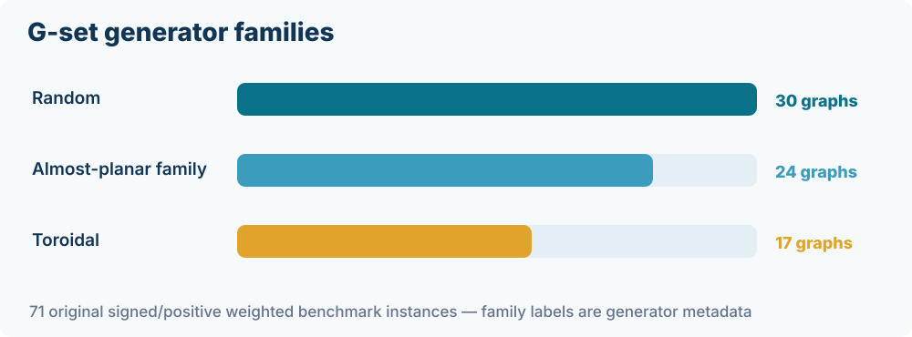

**Benchmark generator families** (secondary metadata):

- **Random:** 30 graphs.
- **Planar-family / almost-planar:** 24 graphs.
- **Toroidal:** 17 graphs.

These categories are useful explanatory variables, but they are **not independent random samples of all possible graphs**.

Original inputs supply **edges and weights**, not canonical vertex coordinates.

Sources: `notes/experiments/experiment022-graph-structure-methods.md`; OpenIsing G-set metadata.

---

## Graph drawing is not graph topology

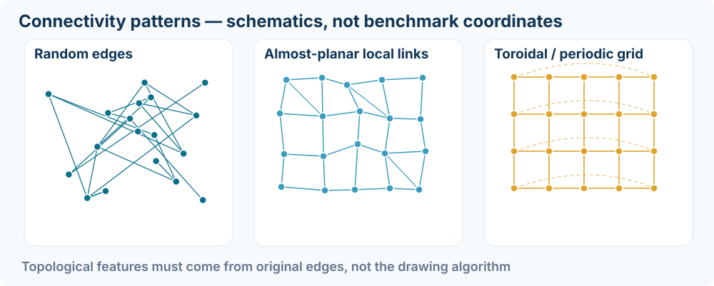

The illustrations are **schematic**. A spring-layout ring, PCA cloud or low-dimensional EVA projection does **not** prove a graph is spatially circular.

Measure connectivity from the **original adjacency lists**, and independently measure **EVA vector geometry** from the frozen factors.

---

## Real structural signatures: four audited examples

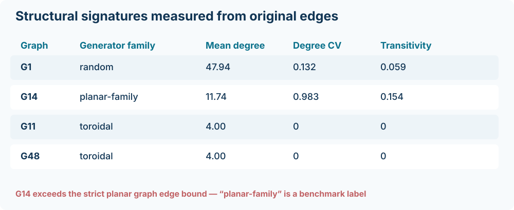

- **Degree coefficient of variation** captures irregularity.
- **Transitivity** measures the fraction of connected triples closed into triangles.
- **G11 and G48** are degree-four and triangle-free; short **four-cycles** and signed frustration may be more diagnostic.

The published **planar-family** label is not a proof of mathematical planarity. G14 has more than \(3n-6\) edges.

---

## Experiment022 — Winners change across graph families

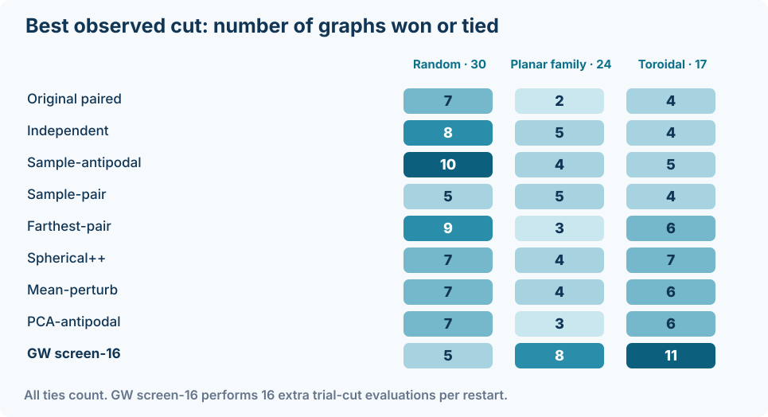

**Best of 50 starts**, after the same refinement protocol:

- Random: **sample-antipodal**, best/tied on **10/30**.
- Planar-family: **GW screen-16**, **8/24**.
- Toroidal: **GW screen-16**, **11/17**.

Several methods tie. The table counts **all tied winners**—it is not a set of mutually exclusive victories.

Source: Experiment022 `method_by_family.csv`.

---

## Screened hyperplanes: strong descriptive topology association

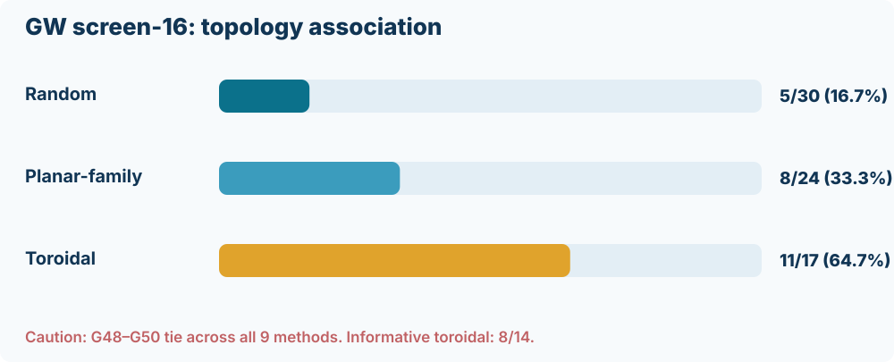

GW screen-16 ties or wins the highest cut on **5/30 random**, **8/24 planar-family**, and **11/17 toroidal** graphs.

But G48–G50 are **uninformative**: all nine methods reach the same best cut.

Excluding those three: **8 of 14 informative toroidal graphs**.

**Budget warning:** screening uses **16 additional initial cut evaluations per restart**. The difference is not a fair, equal-time method comparison.

---

## A high win frequency does not imply a high mean cut

**Graphwise mean final-cut difference versus paired K-MeansNM:**

| Initializer | Random (30) | Planar-family (24) | Toroidal (17) |
|---|---:|---:|---:|
| GW screen-16 | +0.115 | **−0.399** | **+0.605** |
| Sample-antipodal | −0.374 | −1.196 | −0.518 |
| Mean perturbation | −0.615 | −0.671 | **+0.452** |
| Original paired | 0 | 0 | 0 |

These are **raw cut-weight units**, not percentages. Best-of-50 wins and 50-run means answer **different questions**.

Source: Experiment022 `method_by_family.csv`.

---

## Can we select a method for an unseen graph?

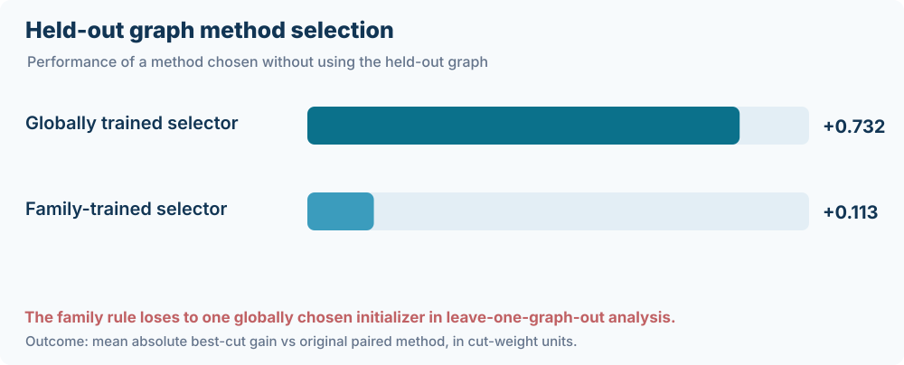

We evaluated a **leave-one-graph-out** rule:

1. Exclude the held-out graph entirely.
2. Choose a method from the other 70 graphs.
3. Test its best-of-50 cut on the held-out graph.

**Mean held-out gain vs paired:**

- Global method selection: **+0.732**.
- Family-specific selection: **+0.113**.

**Conclusion:** the simple family rule did **not** outperform one globally chosen method. The descriptive association is not yet a predictive algorithm.

---

## Why topology alone is insufficient


**Possible confounders** are intertwined with graph family:

- Number of vertices, edges and degree distribution.
- Positive-only versus **signed ±1** weights.
- Cycles, frustration, components, connectivity and spectral gap.
- Nonconvex EVA factor geometry and effective rank.
- Generator siblings and repeated graph designs.

**Next test:** a pre-registered selector using structural features, evaluated with **held-out graph families**, and with equalized compute.

---

<!-- _class: chapter -->

# 7. What about the older MST, EM and coarsening methods?

The historical study gives **additional evidence**, but its coverage and search budgets differ.

---

## Audit the amount of actual comparable evidence

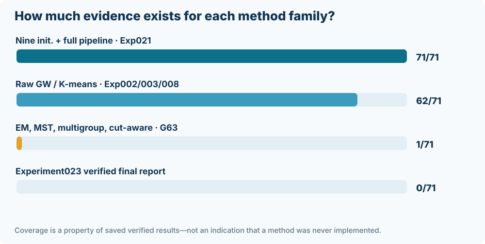

**Three evidence strata** (do not pool):

1. **71 graphs:** nine Experiment021 initialization methods, complete Round → Flip → KL → ILS.
2. **62 graphs:** archived **20-start raw rounding** by GW/FJ, K-Means2N and antipodal K-MeansNM.
3. **G63 only:** MST, soft EM/CEM/Gibbs, multi-group K-means, cut-aware and specialized KL/ILS trials.

**Experiment023:** 17 registered protocols; **no verified complete numerical report** found on its branch at deck preparation.

---

## Historical raw rounding: the antipodal control is strong

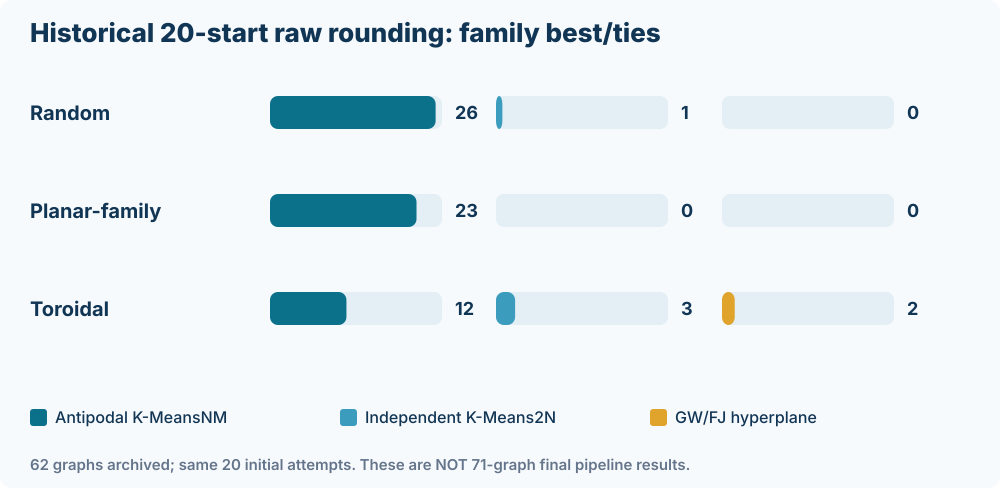

From the archived **62-graph**, **20-start** raw rounding comparison:

- Random: antipodal K-MeansNM wins/ties on **26/27**.
- Planar-family: **23/23**.
- Toroidal: **12/12**.

Overall, it wins or ties on **61/62** graphs among these three algorithms.

**Not the same endpoint:** these are **unrefined** partitions from Exp002/003/008, not the 50-restart Experiment021 finals.

---

## How much did antipodal K-means improve over raw GW?

At the **best-of-20 rounding stage**, unweighted mean within-family relative improvements were:

| Family | Graphs with archived raw results | Mean relative K-MeansNM gain vs GW/FJ |
|---|---:|---:|
| Random | 27 | **+2.032%** |
| Planar-family | 23 | **+1.723%** |
| Toroidal | 12 | **+1.019%** |

These are descriptive, graph-normalized **best-of-20** comparisons, not approximation guarantees or global significance tests.

*Different restart and refinement budgets prevent direct numerical pooling with Experiment021.*

---

## Exact MSTs in the high-dimensional EVA space


1. Compute an exact MST over **all EVA vectors** in \(\mathbb R^p\); metric: L1, L2 or L∞.
2. Remove one edge (**longest**, **balanced**, **diameter center** or **best original cut**) or several edges.
3. Merge components into two **binary** cut sides.
4. Evaluate signed cut and optionally refine original vertices.

**Important:** the MST is built from **vector distances**, not the signed graph weights.

Cost: roughly \(O(n^2p)\) for each exact full-space MST; large graphs need explicit feasibility checks.

---

## Why one MST edge is not always enough

For a tree edge \(e\), the resulting cut can be written as

\[
C(e)=\sum_{\{i,j\}\in E}w_{ij}\,\mathbf 1[e\in P_T(i,j)],
\]

where \(P_T(i,j)\) is the unique path between \(i\) and \(j\) on the **geometric MST**.

- Longest edge optimizes **distance**, not signed cut.
- **Best-cut edge** explicitly scores all \(n-1\) possible one-edge tree splits.
- Multi-edge coarsening optimizes over a contracted **signed** graph.

This suggests a structural hypothesis: **MST performance should depend on how EVA-space geometry aligns with graph-edge frustration**.

---

## Soft EM-like rounding versus hard K-means


Instead of hard cluster membership, assign \(p_i\in[0,1]\) and optimize a **mean-field objective** combining:

- Expected **signed Max-Cut** under independent Bernoulli labels.
- Geometric agreement with EVA centroids.
- Entropy regularization / temperature annealing.

Then generate hard candidates through **thresholding, CEM or Gibbs**, with optional KL refinement.

**Not standard maximum-likelihood EM:** the repository calls this an **EM-like variational alternating** procedure.

---

## The elite-source trap: retaining is not improving

**G63 historical record: 26,917** was already achieved by the Experiment013 K-MeansNM + Flips + KL + ILS pipeline.

Experiment016's **elite-initialized EM/CEM/Gibbs** variants also reported **26,917**.

However, their starting **source partition already achieved 26,917**, and none of those elite episodes improved its source cut.

**Interpretation:** matching the historical record by retaining an elite is **not** evidence that EM independently discovered that solution.

The new Experiment023 protocol deliberately excludes elite warm starts from its primary EM arms.

---

## G63 case study: cross-method scores, different budgets

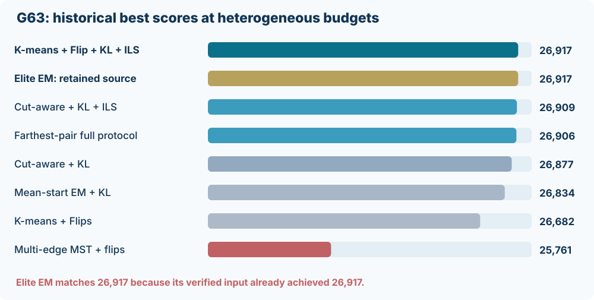

The strongest observed cut remains **26,917** (Experiment013).

- Cut-aware + KL + ILS: **26,909**.
- Farthest-pair full pipeline: **26,906**.
- Mean-start EM + KL: **26,834**.
- Multi-edge MST + vertex flips: **25,761**.

**Do not rank them as if they had equal attempts or identical postprocessing**. The figure is a verified historical **archive comparison**, not a controlled tournament.

---

## Multigroup K-means: clustering \(k\) ≠ Max-\(k\)-Cut


For temporary \(k\)-way EVA clusters, aggregate original signed graph edges into \(W_{ab}\).

Then find the best **binary merge**:

\[
C(z)=\sum_{a<b}W_{ab}\mathbf1[z_a\ne z_b],\quad z_a\in\{0,1\}.
\]

With one merge side fixed to remove complement symmetry, there are \(2^{k-1}-1\) nontrivial merges.

At **k=10**, that is **511** distinct nontrivial merges, *conditional on the cluster assignment*. Still only binary Max-Cut.

---

## Historical data cannot settle a topology-wide MST/EM ranking

| Method family | Archived structural coverage | Biggest interpretive issue |
|---|---|---|
| GW/FJ, K-Means2N, K-MeansNM raw | **62** graphs | Different stage than Exp021 |
| Nine initializers + common refinement | **71** graphs | GW screen-16 screening overhead |
| MST, EM, cut-aware, multi-group and advanced search | **G63** chiefly | Different pilots, budgets and stages |
| Direct hyperplane / selected older studies | Historical code/notes | Some consolidated summaries unverified |

**The missing scientific experiment is not another chart.** It is a **new, prospective, consistent benchmark** across graph families.

---

<!-- _class: chapter -->

# 8. Experiment023 — a prospective all-method benchmark

**Registered design · implementation committed · completion not independently verified**

---

## From initializer tournament to a family-wide benchmark

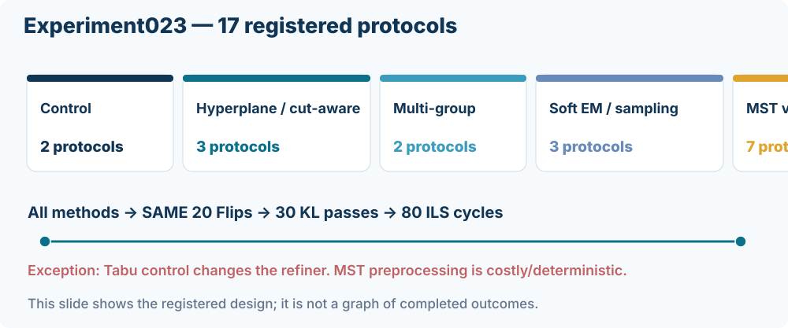

Experiment021 asked: *Which centroid initialization works best?*

Experiment023 asks: **Which whole rounding family yields the strongest cut under a shared refinement policy and bounded computation?**

**17 registered protocols** × **71 original graphs** = **1,207 planned graph-method cells**.

Only **verified completed cells** can later enter an empirical ranking.

---

<!-- _class: compact -->

## The 17 Experiment023 registered protocols

| Rounding / optimization family | Protocols |
|---|---|
| K-means controls | `control-paired`, `control-tabu`* |
| Hyperplane / cut-aware | `gw-threshold`, `cutaware-kmeans`, `hyperplane-sweep` |
| Multi-group EVA clustering | `multigroup-k4`, `multigroup-k8` |
| EM-like and stochastic | `em-hard`, `em-cem`, `em-gibbs` |
| Exact L2 MST | `mst-l2-longest`, `-balanced`, `-diameter`, `-bestcut`, `-multicut` |
| Exact alternative-distance MST | `mst-l1-bestcut`, `mst-linf-bestcut` |

*Tabu changes the **refiner**, not merely an initializer; analyze separately.*

---

## The full-run common downstream pipeline


For **comparable hard binary seeds**, use:

**Round → up to 20 positive flip sweeps → 30 generalized KL passes → 80 ILS cycles** (eight inner KL passes; kicks 8/16/32/64).

**Maximum 100 restarts or a 240-second per-method wall-time budget**, whichever comes first, with hard timeout at 510 seconds.

MST is deterministic per factor and metric; **do not pretend repeated identical trees are independent restarts**.

---

## The fairness protocol: control what is comparable

One graph, one frozen source factor, same original signed cut objective.

Record separately:

1. **Raw** candidate score before refinement.
2. Flip, KL and ILS **final** scores.
3. Factor/graph SHA, preprocessing cost, evaluations and wall time.
4. Warm-start or elite source (if any), seeds and trace.
5. **Timeout**, failure, budget-limited or completed status.

The 240-second target is a **ceiling**, not a mathematically exact equal-work guarantee. MST preprocessing and EM sampling may dominate the cost.

---

## Pilot gate → complete sweep → coverage audit

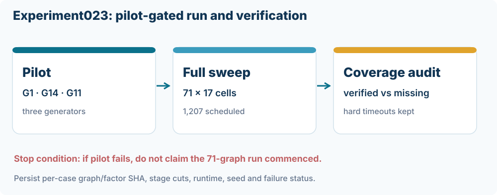

**Pilot graphs:** G1 (random), G14 (planar-family), G11 (toroidal).

- Validate code, factor hashes, feasible cuts and computational costs.
- Full workflow starts **only if every pilot succeeds**.
- One self-hosted Windows runner; checkpoint one graph at a time.
- Audit a **71 × 17 = 1,207-cell** outcome matrix.

**A declared cell is not a completed run.** A timeout must remain visible in the final report.

---

## Evidence status: separate proven data from the planned study

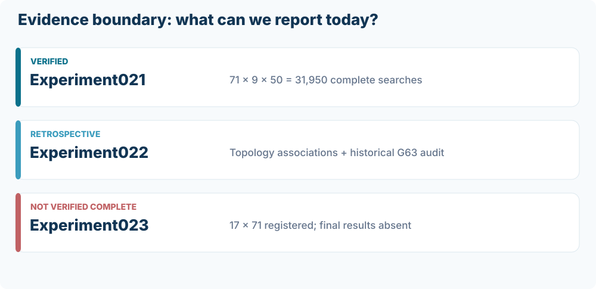
At preparation, the Experiment023 branch contained its workflow, methods and protocol but **no verified final coverage/report JSON**.

**Therefore, this presentation gives no invented Experiment023 winner, score, speedup or topology-specific conclusion.**

Link: [Experiment023 protocol](https://github.com/heri-espino/maxkcut/blob/experiment023-all-method-topology/notes/experiments/experiment023-all-method-topology.md).

---

## How to analyze Experiment023 when results exist

**Primary question:** within each original graph and a bounded budget, which method returns the best *verified feasible* cut?

A prespecified analysis should include:

- **Within-graph normalized gain** against new paired control.
- Fractional wins with ties split across winning protocols.
- Runtime-quality **Pareto frontier**; shared MST cache cost allocation.
- Separate positive-only and signed-weight graphs.
- Random / planar-family / toroidal **stratification**.
- Leave-generator-family-out validation and graph-level intervals.

Do not pool 1,207 correlated cells as 1,207 independent graph samples.

---

<!-- _class: chapter -->

# 9. What we learned — and what remains open

A scientific story of **reproducible experimentation**, not a single champion score.

---

## The full research trajectory, one view

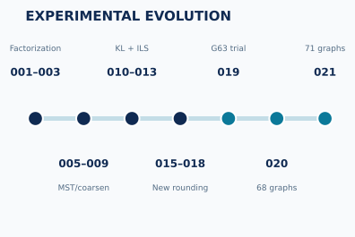

**Early program:** factor construction, GW/K-means, exact MST, KL/Tabu, multigroup and soft EM.

**Experiment021:** 71 verified graphs, 31,950 initializations/refinements.

**Experiment022:** topology and historical-coverage retrospective audit.

**Experiment023:** prospective all-family protocol designed; final run evidence still pending.

---

## Four different questions must stay distinct

| Question | Statistic | Current strongest evidence |
|---|---|---|
| Best *individual* cut? | Best-of-50 | GW screen-16 most best/ties in Exp021 |
| Best *typical* restart? | Graphwise mean final cut | Original paired is competitive; GW +0.059 raw units |
| Best method for a **graph family**? | Family-stratified wins | Descriptive GW toroidal association; not predictive yet |
| Best method *per CPU-second*? | Equal-budget anytime cuts | **Not established** by Exp021/022; Experiment023 proposed |

These distinctions prevent choosing a champion by **changing the evaluation target after seeing results**.

---

## What can be concluded rigorously from this record?

**Supported statements:**

- The original graph and final feasible signed Max-Cut are independently verified.
- The G-set Experiment021 study is **complete**: 71 graphs and 31,950 searches.
- GW screen-16 achieved the most best-cut ties/wins, but spent more initial evaluations.
- Graph generator family correlates with some observed method wins.
- The simple topology selector did not beat global selection in held-out comparison.
- Historical MST/EM results cannot justify all-graph ranking without wider runs.

**Not supported:** new SDP optimality certificate, a Max-\(k\)-Cut (\(k>2\)) claim, equal-budget superiority, or final Experiment023 winners.

---

## Reproducibility: every claim links to an archive

| Item | Source of truth |
|---|---|
| Canonical signed G-set inputs | `data/G*.txt` |
| Experiment021 complete cuts/restarts | `results/gset/experiment021-.../statistics/` |
| Experiment022 labels/LOOCV/history | `results/gset/experiment022-graph-structure-methods/` |
| Experiment023 registered protocol | `notes/experiments/experiment023-all-method-topology.md` |
| Experimental implementation | `src/maxkcut/` |
| Regenerable vector charts | `presentations/.../build_new_figures.py` |

Retain source factor SHA, graph SHA, verified partition, configuration ID and method-stage timing in all future reports.

---

## Immediate next scientific checkpoints

**After the Experiment023 pilot and sweep:**

1. Audit complete graph-method **coverage and timeouts**.
2. Re-score every archived cut and validate source-factor identity.
3. Compare **cut vs wall-time** under the same method budget.
4. Measure structural predictors: degree CV, cycles, sign fraction and EVA spectrum.
5. Evaluate structural method selectors on graph families withheld from training.
6. Report effect size, graph-level uncertainty, multiplicity and negative results.

The **method × topology** hypothesis remains open until the planned new outputs are verified.

---

<!-- _class: chapter -->

# Final synthesis

**There is no single universal winner yet.** We have a complete nine-initializer benchmark, new topology associations, an audited history of alternative algorithms, and a controlled plan to test them all.

---

<!-- _class: small -->

## Literature and permanent experiment sources

**Research foundations**

- Rodríguez Fernández, Á. E. (2021). *On the Study of Fitness Landscapes and the Max-Cut Problem* (Chs. 6–7).
- Rodríguez-Fernández, Á. E., et al. (2020). *Clustering Improves the Goemans–Williamson Approximation for the Max-Cut Problem*. *Computation* **8**, 75. DOI: [10.3390/computation8030075](https://doi.org/10.3390/computation8030075).
- Felzenszwalb, P., Klivans, C., & Paul, A. (2022). *Clustering with Semidefinite Programming and Fixed Point Iteration*. *JMLR* **23**, 21-0402.

**Primary archived results and design**

- [Experiment021 report — full 71 graphs](https://github.com/heri-espino/maxkcut/blob/main/results/gset/experiment021-complete-71-gset/statistics/report.json).
- [Experiment022 note — topology and historical methods](https://github.com/heri-espino/maxkcut/blob/experiment022-graph-structure-methods/notes/experiments/experiment022-graph-structure-methods.md).
- [Experiment023 note — future outcomes not verified](https://github.com/heri-espino/maxkcut/blob/experiment023-all-method-topology/notes/experiments/experiment023-all-method-topology.md).

**Prepared for Professor Ángel E. Rodríguez Fernández · 29 October 2026.**