<!-- _class: cover -->

# From K-Means Initialization to Topology-Aware Max-Cut

### A reproducible graph-structure-aware comparison across 71 G-set instances

**SDP-inspired vector factors · spherical clustering · local search · G-set**

Experiments 001–027 · 8 November 2026

**Prepared for Professor Ángel E. Rodríguez Fernández**

---

<!-- _class: compact -->

## Numerical milestones — Experiment025 and Experiment027

| Metric | Full-quality Experiment025 result |
|---|---:|
| G-set graphs | **71 / 71** |
| Initialization/refinement protocols | **18 / 18** |
| Shared GW directions per graph and protocol | **16 / 16** |
| Complete graph–method combinations | **1,278 / 1,278** |
| Full refinements recorded as completed | **20,448 / 20,448** |

**Experiment027 extension:** 3 more angular-guided methods × 16 matched GW directions × 71 graphs = **3,408 new full-quality seeds**, now independently audited with GW and HP comparators and published to GitHub Releases.

**Primary comparison:** highest verified original signed Max-Cut encountered at any initializer, Flip, KL or ILS iteration — not the last walking state.

**Status boundary:** Experiment027's selected 5-method archives have been audited/published; Experiment025's **full 18-method** raw archive still lacks a complete independent off-VM verification.

Source: Experiment025 local completion note and uploaded full 1,278-row aggregate CSV. No EVA/SDP was recomputed.

---

## Historical milestone — Experiment021

| Scope | Verified result |
|---|---:|
| Canonical G-set graphs | **71 / 71** |
| Initialization families | **9** |
| Matched restarts per graph and method | **50** |
| Fully archived Max-Cut searches | **31,950** |
| Missing factors / incomplete graphs | **0 / 0** |
| Graphs where best-of-nine beats best-of-control | **58 / 71** |

**Important:** these are feasible **binary Max-Cut** results, **not** certified global optima or a general Max-$k$-Cut result for $k>2$.

Source: [Experiment021 report](https://github.com/heri-espino/maxkcut/blob/main/results/gset/experiment021-complete-71-gset/statistics/report.json).

**This counts Experiment021 only; do not add 1,207 scheduled Experiment023 cells to completed searches.**

---

## Research map: the verified experimental backbone

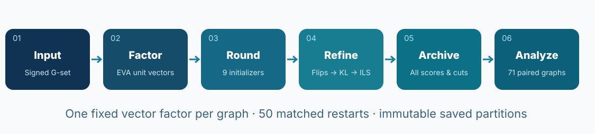

One graph, one immutable vector factor, multiple comparable rounding strategies, exact re-scoring and archived outputs.

---

<!-- _class: chapter -->

# 1. What problem did we solve?

From a discrete graph partition to a geometric representation.

---

## Formal objective: signed Max-Cut

For an undirected graph $G=(V,E,w)$, choose binary labels $c_i\in\{0,1\}$:

$$
\max_{c\in\{0,1\}^{|V|}} C(c),\qquad
C(c)=\sum_{\{i,j\}\in E}w_{ij}\,\mathbf 1[c_i\ne c_j].
$$

- **Positive** $w_{ij}$: rewards placing endpoints on opposite sides.
- **Negative** $w_{ij}$: penalizes separating the endpoints.
- All reported cut scores use the **original signed weights**.

The clustering objective is **not** the cut objective: it proposes a partition that must subsequently be evaluated on the graph.

---

## Classical SDP relaxation (the theoretical reference)

Let $L=D-W$ and $X=VV^\top$ be a Gram matrix. For general $k\ge2$:

$$
\max_{X\succeq0,\,X_{ii}=1}\frac{k-1}{2k}\operatorname{Tr}(LX),
\qquad X_{ij}\ge-\frac{1}{k-1}\quad(k>2).
$$

At $k=2$, the pairwise lower bound is redundant. Factorization represents each vertex $i$ by a unit vector $v_i$.

**Crucial distinction:** the large-scale campaign used **rank-restricted nonconvex EVA factors**; these are not proven solutions or certified bounds for the full convex SDP.

Source: repository `AGENTS.md`, `RESEARCH_HANDOFF.md` and Rodríguez Fernández (2021, Chapters 6–7).

---

## Goemans–Williamson: random hyperplane rounding

Draw $r\sim N(0,I_p)$ and set

$$
c_i=\mathbf 1[v_i^\top r<0].
$$

The hyperplane $v^\top r=0$ separates embedded vertices into two sides.

**The starting question:** why choose an arbitrary hyperplane if the vector embedding already contains structure from an optimization problem?

- Replace the initial two-way split with **spherical clustering**.
- Keep the original graph cut as the evaluation metric.
- Preserve the GW-equivalent starting cut in the original K-MeansNM control.

Source: Rodríguez-Fernández et al. (2020), Sections 1–3.

---

## How spherical K-means enters Max-Cut rounding

**Original K-MeansNM** initializes two unit centroids as $u$ and $-u$. Its first assignment is the GW hyperplane partition.

Then alternate:

1. Assign each $v_i$ to the centroid with maximum dot product.
2. Normalize each cluster's mean to update its centroid.
3. Keep the **best original-graph cut observed along the trajectory**.

Geometric distortion can decrease without the cut increasing at every step. This is why evaluating **intermediate** iterates matters.

Source: Rodríguez-Fernández et al. (2020), Eq. (4), Lemma 1 and Section 3.1.

---

## Three foundations from the literature

| Work | What it contributed to our design |
|---|---|
| Rodríguez Fernández (2021), thesis | Max-Cut / Max-$k$-Cut, SDP geometry, fitness landscapes, clustering rounding |
| Rodríguez-Fernández et al. (2020) | K-MeansNM, K-Means2N and comparison with GW on G-set |
| Felzenszwalb, Klivans & Paul (2022) | Convex geometry of the $k$-way elliptope and iterative fixed-point rounding |

The 2022 fixed-point method is **related prior art**, not a claimed component of our Experiment021 implementation.

Sources: project PDFs and [research handoff](https://github.com/heri-espino/maxkcut/blob/experiment021-complete-71-gset/RESEARCH_HANDOFF.md).

---

<!-- _class: chapter -->

# 2. How the research evolved

Prototypes, failed hypotheses, stronger refiners and a controlled comparison.

---

<!-- _class: compact -->

## Experimental chronology: from groundwork to a stable pipeline

| Experiments | Research direction | What we learned |
|---|---|---|
| 001–003 | I/O, full SDP tests, EVA vector factors and checkpoints | Separate exact graph scoring from numerical factor optimization |
| 005–009 | MST partitions, balanced cuts, forest coarsening | Geometry-only bipartitions can be too restrictive |
| 010–013 | Generalized KL, Tabu, cut-aware rounding, pipeline grid, ILS | Post-rounding search is essential; historic G63 best **26,917** |
| 015–016 | Direct hyperplane optimization; soft Bernoulli / entropy approaches | Alternative searches did not replace the strongest pipeline |
| 017–018 | Multi-group clustering, exact binary merging; nine initializers | Fix the downstream pipeline and test initialization systematically |
| 019–021 | Matched G63 experiment, 68-graph expansion, 71-graph completion | Produce a complete auditable statistical dataset |

**Numbering note:** unlisted experiment IDs are not asserted to be completed.

Source: `RESEARCH_HANDOFF.md` and the individual experiment notes.

---

## Step 1 — Build a verifiable experimental substrate

- Keep canonical G-set text graphs, signed weighted edge lists and hashes.
- Implement numerical scoring separately from factor generation.
- Compare the small full-convex SDP pathway with scalable EVA approaches.
- Save reusable factors, iteration histories, seeds and binary partitions.
- Protect large jobs with explicit hardware/resource guards.

**Why:** we needed to distinguish a better *rounded cut* from a different embedding, input graph or solver approximation.

Repo: `src/maxkcut/{objective.py,sdp.py,eva.py,archive.py}`; Experiments001–003.

---

## Step 2 — Obtain geometry with EVA

EVA optimizes a **rank-restricted vector relaxation** over row-unit embeddings $Y\in\mathbb R^{n\times p}$, with $Y_i$ representing vertex $i$.

For the three final missing instances:

$$
p=\lceil\sqrt{2(n+1)}\rceil=119\quad\text{for }n=7000.
$$

- Sequential Numba updates; one BLAS thread.
- Maximum 10,000 sweeps; angular tolerance **0.001 radians**.
- Seed **2026**; checkpoints every **25** sweeps.
- **No claim** of full-SDP convergence or global optimality.

Source: Experiment021 note and `.github/workflows/experiment021-complete-gset.yml`.

---

## Step 3 — Test alternatives to naive rounding

**MST approaches (005–009):** full-dimensional Euclidean / other distances; tree-edge removals, multicomponent contractions, binary regrouping and vertex refinement.

**Reason for moving on:** rigid geometric clusters could miss good signed-graph cuts; G63's one-edge MST result was far below the later K-MeansNM + refinement baseline.

**Critical invariant:** when $q$ MST edges are removed, the $q+1$ components are subsequently assigned back to **two** Max-Cut sides, not treated as $q+1$-Cut solutions.

Source: Experiment005 and Experiment009 notes.

---

## Step 4 — Improve a cut with exact vertex gains

Represent side labels by spins $s_i\in\{-1,+1\}$:

$$
C(s)=\frac12\sum_{\{i,j\}\in E} w_{ij}(1-s_is_j),
\qquad
\Delta_i=s_i\sum_{j:\{i,j\}\in E}w_{ij}s_j.
$$

Here $\Delta_i$ is the **exact change in cut** produced by flipping vertex $i$.

- **Flips:** accept positive-gain moves until locally stable or out of sweeps.
- Use the original signed sparse graph; update neighboring gains efficiently.
- Retain and independently rescore the resulting feasible partition.

Source: Experiment010 note, `src/maxkcut/` local-search implementation.

---

## Step 5 — Escape the one-flip local optimum

**Generalized KL** (not classical balanced pair-swapping):

1. In one pass, repeatedly choose the highest-gain unlocked vertex.
2. Permit temporarily negative gains.
3. Remember the best **strictly positive cumulative prefix**.
4. Accept that prefix; repeat up to the pass budget.

**Iterated Local Search (ILS):** perturb an elite partition, run inner KL, retain the best feasible cut visited.

This explains why the final score can be much stronger than the initial spherical clustering score.

Source: Experiments010 and 013; see [Experiment019 pipeline](https://github.com/heri-espino/maxkcut/blob/experiment021-complete-71-gset/notes/experiments/experiment019-kmeans-init-full-pipeline.md).

---

## Step 6 — Select the full refinement pipeline (Experiment013)

```text
Frozen EVA vector factor
       ↓
Round with candidate method
       ↓
Positive-gain vertex flips
       ↓
Generalized signed KL
       ↓
KL-based iterated local search
       ↓
Final feasible signed Max-Cut + archived partition
```

The historically best verified **G63 feasible cut was 26,917**. The exploratory **27,047** target remained 130 higher and was **not** a proven optimum.

Source: `configs/experiment013-grid.json`, Experiment013 note.

---

<!-- _class: compact -->

## Step 7 — Explore other models, but preserve the main baseline

| Experiment | Hypothesis tested | Methodological distinction |
|---|---|---|
| 015 | A better rounding normal may be found directly | Exact great-semicircle event sweeps; stochastic smoothed-gradient ascent |
| 016 | Soft partition distributions may escape hard-rounding limitations | Entropy-regularized Bernoulli assignments, CEM/Gibbs proposals |
| 017 | More than two clusters may reveal useful latent structure | 2/4/6/8/10 groups, **exact** merge back to binary cuts |
| 018 | Initialization of two centers may be the main lever | Nine systematic initializer families |

For Experiment017, $q$ geometric groups can be merged to two labels by enumerating $2^{q-1}-1$ nontrivial complements; at $q=10$, **511** mergers.

These experiments motivate **controlled initialization comparisons**, not a claim that every exploratory strategy improved the G63 record.

---

<!-- _class: chapter -->

# 3. The frozen comparison protocol

Nine initializers, one embedding per graph, identical downstream budgets.

---

<!-- _class: compact -->

## The nine initialization methods: part I

| Name | How the initial centroids were selected |
|---|---|
| **Original paired K-MeansNM** | Random unit vector $u$ and antipode $-u$ |
| **Independent centers** | Two independently drawn random unit directions |
| **Sample antipodal** | An actual embedding row $Y_i$ and $-Y_i$ |
| **Sample pair** | Two different randomly chosen embedding rows |
| **Farthest pair** | One sampled row and a row maximally distant by cosine |

All methods operate on the same graph-specific, **fixed EVA factor**.

Source: Experiment018 note and Experiment021 methodology.

---

<!-- _class: compact -->

## The nine initialization methods: part II

| Name | How the initial centroids were selected |
|---|---|
| **Spherical K-means++** | First sampled row; second selected by distance-squared weighting |
| **Mean perturbation** | Two perturbations around the normalized embedding mean |
| **PCA antipodal** | Leading centered principal direction + jitter, then antipode |
| **GW screen-16** | Evaluate 16 random candidate hyperplanes and choose the best |

**Budget warning:** GW screen-16 uses **16 additional graph-cut evaluations** per restart, and PCA has preprocessing costs. Equal restarts does **not** mean equal compute.

Source: Experiment018 note.

---

## Identical downstream refinement for every method

| Stage | Frozen setting |
|---|---|
| Spherical Lloyd | $k=2$, up to **100** iterations; keep best actual cut |
| Positive vertex flips | Up to **20** sweeps |
| Generalized KL | Up to **30** passes |
| KL-based ILS | **80** cycles; **8** inner KL passes |
| ILS perturbation sizes | **8, 16, 32, 64** vertices |
| ILS temperature | **12** |
| Restarts | **50** per graph and method |

All scores are recorded at **Round → Flip → KL → Final**.

Source: Experiments019–021.

---

## Reproducible RNG design: matched downstream seeds

Graph index $g$, restart $r\in\{0,\ldots,49\}$, seed base **2026**:

```python
# Two-center rounding initialization
SeedSequence([2026, g, 2, r, 0])  # paired control
SeedSequence([2026, g, 2, r, 1])  # alternative methods

# Same postprocessing streams across methods, for matched r
flips_seed = [2026, g, r, 1313]
kl_seed    = [2026, g, r, 101]
ils_seed   = [2026, g, r, 1401]
```

Matched restart IDs control the **postprocessor randomness**, not the actual random initial centers drawn by different methods.

Source: Experiment019 and Experiment021 notes.

---

## Experiment019 — Controlled pilot on G63

- Original G63 graph: **7,000 vertices**; fixed EVA factor with **119 columns**.
- **9 × 50 = 450** matched, full four-stage searches.
- Best new Experiment019 cut: **26,906** (farthest pair).
- Historical verified feasible record: **26,917** (Experiment013).
- Exploratory target: **27,047**, not a certified optimum.

**Interpretation:** the initializer pilot did not improve the historical G63 record, but gave a well-controlled design suitable for all G-set graphs.

Source: Experiment019 note; `RESEARCH_HANDOFF.md`.

---

<!-- _class: chapter -->

# 4. From one graph to all 71

Windows self-hosted GitHub Actions, resumability and exact coverage checks.

---

## Experiment020 — Expand to the 68 graphs with saved factors

**Goal:** reuse already completed EVA embeddings; do not rerun the expensive factor solves.

- **68** eligible graphs with verified factors: **67 new** + reused G63.
- **68 × 9 × 50 = 30,600** archived full searches.
- **G60, G61, G62** initially excluded because matching completed factors were missing.
- **32** parallel Windows worker processes for rounding/refinement.

A failed first workflow exposed a Windows worker race while writing JSON summaries. Recovery moved per-graph publication **after worker completion** and reused intact saved graph chunks.

Sources: [Experiment020 report](https://github.com/heri-espino/maxkcut/blob/experiment021-complete-71-gset/notes/experiments/experiment020-all-gset-paired-inits.md), [recovery run](https://github.com/heri-espino/maxkcut/actions/runs/40826652014).

---

## Why the self-hosted runner mattered

```text
GitHub Actions dispatch / dedicated research branch
                ↓
Windows 11 runner + maxkcut Conda Python
                ↓
Factor/hash checks + fast regression tests
                ↓
32 independent search workers; resumable chunks
                ↓
Post-join aggregation and exact archive verification
                ↓
Commit + push to experiment branch; upload artifact
```

**Runner usage did not itself guarantee correct data**: input hashes, process synchronization, restart completeness, seed identity and independent rescore checks were all required.

---

## Experiment021 — Generate exactly the missing EVA factors

| Graph | Vertices | Edges | EVA sweeps | Recorded state |
|---|---:|---:|---:|---|
| **G60** | 7,000 | 17,148 | 239 | converged |
| **G61** | 7,000 | 17,148 | 235 | converged |
| **G62** | 7,000 | 14,000 | 571 | converged |

Only these three new nonconvex factors were generated. Original Experiment019/020 factor files and search results remained unchanged.

**Then:** 3 × 9 × 50 = **1,350** new Round→Flip→KL→ILS searches.

Source: [Experiment021 note](https://github.com/heri-espino/maxkcut/blob/experiment021-complete-71-gset/notes/experiments/experiment021-complete-71-gset.md).

---

## Final completeness proof is a machine-checked ledger

$$
\underbrace{68\times9\times50}_{30{,}600\text{ reused}}
+\underbrace{3\times9\times50}_{1{,}350\text{ new}}
=\boxed{31{,}950}.
$$

The consolidated report requires:

- Exactly **71** canonical graph identities.
- Exactly **nine** methods and **50** restart IDs per graph.
- **Zero** missing factors and **zero** incomplete instances.
- Original graph and factor **SHA-256** identities intact.
- Complete saved scores, partition files and per-restart traces.

Passed: [GitHub Actions #40831249367](https://github.com/heri-espino/maxkcut/actions/runs/40831249367).

---

<!-- _class: chapter -->

# 5. Results and interpretation

Distinguishing best individual cuts from average performance.

---

<!-- _class: small -->

## Ranking A — Who reached the best cut on most graphs?

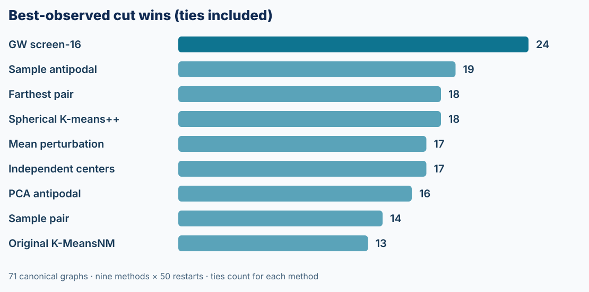

**Best-cut ties count for all tied methods.** Values are graph counts out of 71; they need not sum to 71.

Source: `statistics/per_instance_methods.csv`, recomputed from `best_final`.

---

<!-- _class: compact -->

## Ranking B — Share credit when several methods tie

| Rank | Initialization | Graphs best (incl. ties) | Sole best | Fractional wins |
|---:|---|---:|---:|---:|
| 1 | **GW screen-16** | **24** | **7** | **12.19** |
| 2 | Farthest pair | 18 | **7** | 9.46 |
| 3 | Sample antipodal | 19 | 5 | 8.75 |
| 4 | Mean perturbation | 17 | 6 | 8.50 |
| 5 | Independent centers | 17 | 4 | 7.21 |
| 6 | Sample pair | 14 | 4 | 6.82 |
| 7 | Spherical K-means++ | 18 | 2 | 6.25 |
| 8 | Original K-MeansNM | 13 | 4 | 5.92 |
| 9 | PCA antipodal | 16 | 3 | 5.91 |

Fractional win = $1/t_g$ for each best-scoring method on graph $g$, where $t_g$ is the number tied for best. The fractional wins sum to **71**.

---

<!-- _class: compact -->

## Ranking C — Average final-cut difference versus control

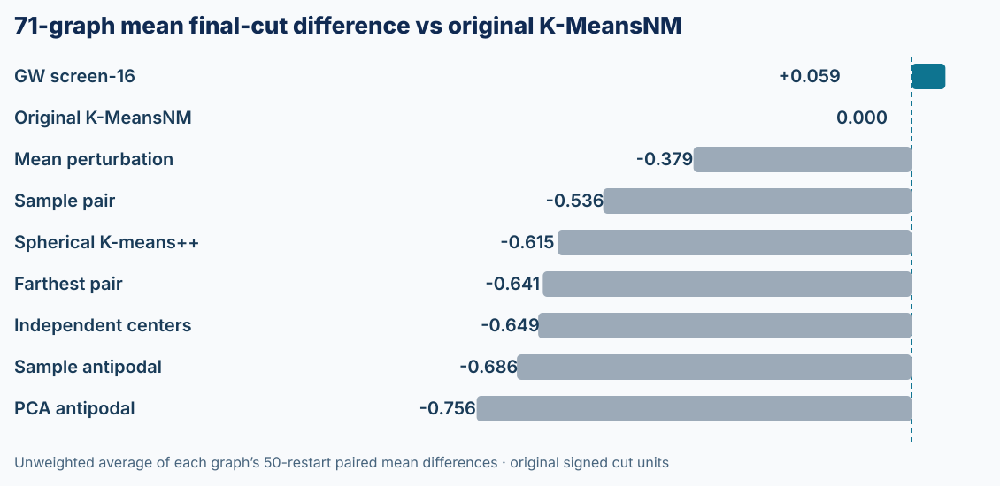

**Method:** calculate each graph's 50-restart mean difference relative to original K-MeansNM; then average the **71 graph-level differences** equally. Positive is better.

Most alternatives are slightly below the control. GW screen-16 is **+0.059 raw cut units**, with extra evaluations and no established statistical dominance.

---

## Three newly completed instances: best observed cuts

| Graph | Best initializer | Best of nine | Control best | Gain |
|---|---|---:|---:|---:|
| **G60** | Sample antipodal | **14,124** | 14,103 | **+21** |
| **G61** | Independent centers | **5,721** | 5,718 | **+3** |
| **G62** | Mean perturbation | **4,816** | 4,808 | **+8** |

All values are **feasible signed Max-Cut scores**, not certificates of optimality.

Source: Experiment021 finalized per-graph records.

---

## Important graph-specific landmarks

**G63**

- Historical best observed feasible cut: **26,917** (Experiment013).
- Experiment019's nine-initializer best: **26,906**.
- Distance from historical record to exploratory **27,047** target: **130**.

**G11**

- A search attained **564** on the canonical instance, matching the repo's cited established optimum for that weighted graph.

Do not transfer historical targets, cut scales or certified-optimum labels between different graph identities.

Sources: `RESEARCH_HANDOFF.md`, Experiment019 note, `docs/gset-reference-values.md`.

---

## Why 58/71 is not an equal-budget victory

The best of nine methods beat the best of 50 control restarts on **58 graphs** and tied on **13**.

But it had up to **450 searches per graph**, versus **50** for the original K-MeansNM alone.

**A portfolio containing the control can never score worse in best-of-search, by construction.** Its 58 victories are empirical evidence of *diversity and opportunity*, not proof that an individual method is more effective per unit computation.

Also, GW screen-16 considers 16 additional initial hyperplanes per restart.

---

## What the statistics do—and do not—show

**Paired comparison** at graph $g$:

$$
\Delta_{g,m}=\frac1{50}\sum_{r=0}^{49}
\left[C^{\rm final}_{g,m,r}-C^{\rm final}_{g,\rm control,r}\right].
$$

- Report the mean of the **71** graph-level $\Delta_{g,m}$ values.
- Within graph, **4,000-replicate paired bootstrap** intervals examine restart variability.
- Do **not** treat 31,950 correlated restarts as independent graphs.
- Do **not** equate a best-of-50 score with expected performance.
- No universal approximation ratio follows from these cut scores.

Source: Experiment021 note; `paired_vs_original_kmeansnm.csv`.

---

<!-- _class: chapter -->

# 6. Does graph topology explain the best initializer?

**Experiment022** · retrospective analysis of the completed 71-graph data

---

## The G-set is not one homogeneous population

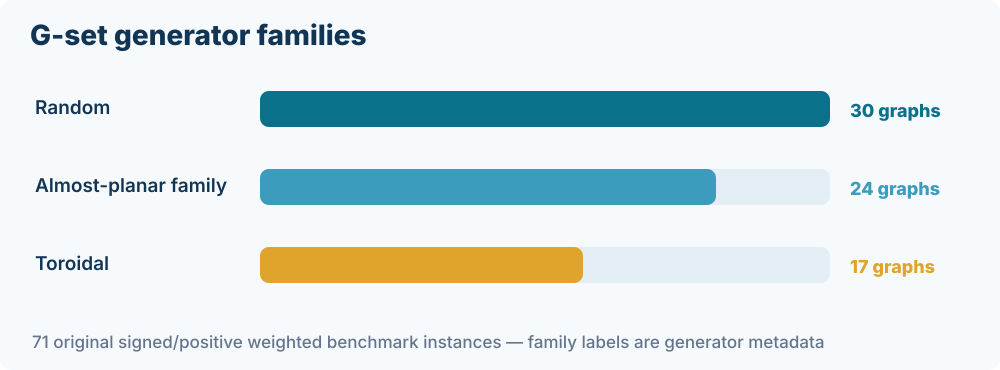

**Benchmark generator families** (secondary metadata):

- **Random:** 30 graphs.
- **Planar-family / almost-planar:** 24 graphs.
- **Toroidal:** 17 graphs.

These categories are useful explanatory variables, but they are **not independent random samples of all possible graphs**.

Original inputs supply **edges and weights**, not canonical vertex coordinates.

Sources: `notes/experiments/experiment022-graph-structure-methods.md`; OpenIsing G-set metadata.

---

## Graph drawing is not graph topology

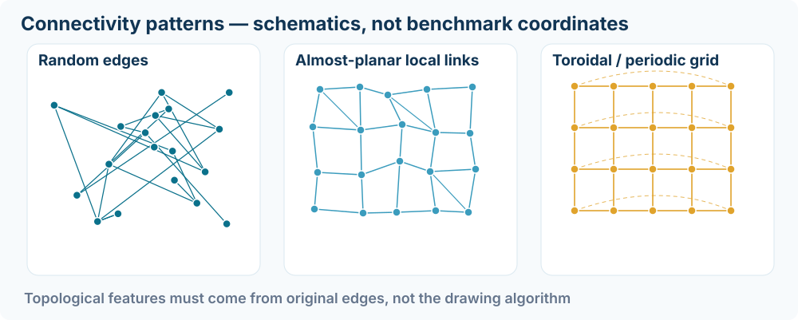

The illustrations are **schematic**. A spring-layout ring, PCA cloud or low-dimensional EVA projection does **not** prove a graph is spatially circular.

Measure connectivity from the **original adjacency lists**, and independently measure **EVA vector geometry** from the frozen factors.

---

## Real structural signatures: four audited examples

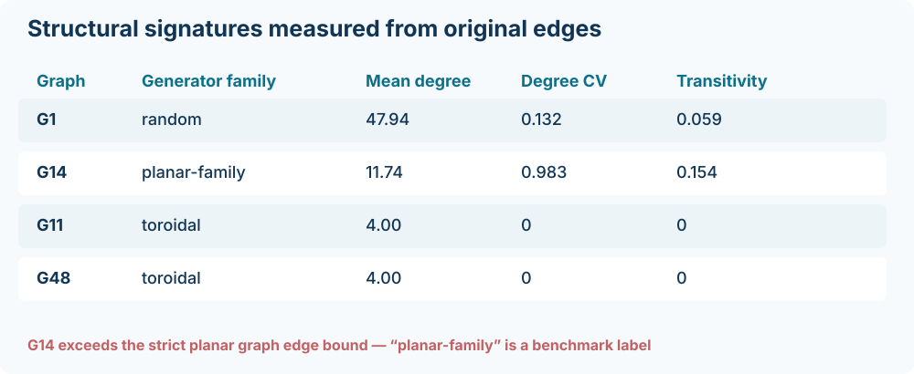

- **Degree coefficient of variation** captures irregularity.
- **Transitivity** measures the fraction of connected triples closed into triangles.
- **G11 and G48** are degree-four and triangle-free; short **four-cycles** and signed frustration may be more diagnostic.

The published **planar-family** label is not a proof of mathematical planarity. G14 has more than $3n-6$ edges.

---

## Experiment022 — Winners change across graph families

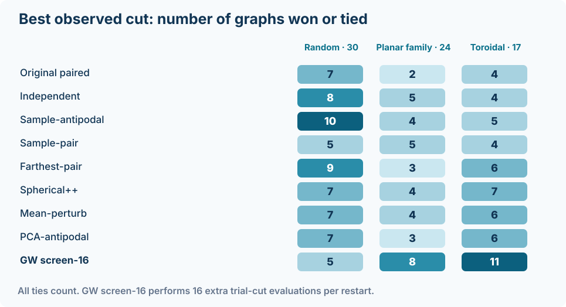

**Best of 50 starts**, after the same refinement protocol:

- Random: **sample-antipodal**, best/tied on **10/30**.
- Planar-family: **GW screen-16**, **8/24**.
- Toroidal: **GW screen-16**, **11/17**.

Several methods tie. The table counts **all tied winners**—it is not a set of mutually exclusive victories.

Source: Experiment022 `method_by_family.csv`.

---

## Screened hyperplanes: strong descriptive topology association

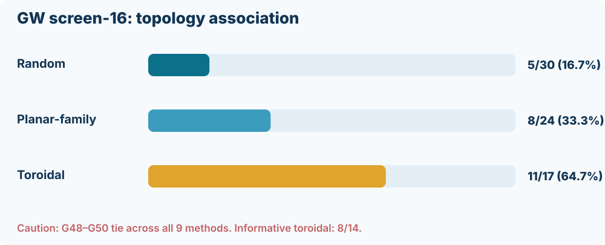

GW screen-16 ties or wins the highest cut on **5/30 random**, **8/24 planar-family**, and **11/17 toroidal** graphs.

But G48–G50 are **uninformative**: all nine methods reach the same best cut.

Excluding those three: **8 of 14 informative toroidal graphs**.

**Budget warning:** screening uses **16 additional initial cut evaluations per restart**. The difference is not a fair, equal-time method comparison.

---

## A high win frequency does not imply a high mean cut

**Graphwise mean final-cut difference versus paired K-MeansNM:**

| Initializer | Random (30) | Planar-family (24) | Toroidal (17) |
|---|---:|---:|---:|
| GW screen-16 | +0.115 | **−0.399** | **+0.605** |
| Sample-antipodal | −0.374 | −1.196 | −0.518 |
| Mean perturbation | −0.615 | −0.671 | **+0.452** |
| Original paired | 0 | 0 | 0 |

These are **raw cut-weight units**, not percentages. Best-of-50 wins and 50-run means answer **different questions**.

Source: Experiment022 `method_by_family.csv`.

---

## Can we select a method for an unseen graph?

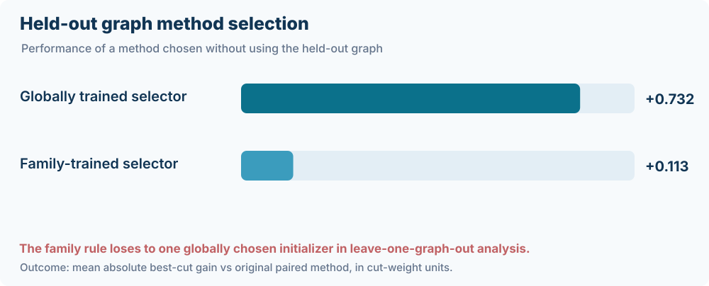

We evaluated a **leave-one-graph-out** rule:

1. Exclude the held-out graph entirely.
2. Choose a method from the other 70 graphs.
3. Test its best-of-50 cut on the held-out graph.

**Mean held-out gain vs paired:**

- Global method selection: **+0.732**.
- Family-specific selection: **+0.113**.

**Conclusion:** the simple family rule did **not** outperform one globally chosen method. The descriptive association is not yet a predictive algorithm.

---

## Why topology alone is insufficient


**Possible confounders** are intertwined with graph family:

- Number of vertices, edges and degree distribution.
- Positive-only versus **signed ±1** weights.
- Cycles, frustration, components, connectivity and spectral gap.
- Nonconvex EVA factor geometry and effective rank.
- Generator siblings and repeated graph designs.

**Next test:** a pre-registered selector using structural features, evaluated with **held-out graph families**, and with equalized compute.

---

<!-- _class: chapter -->

# 7. What about the older MST, EM and coarsening methods?

The historical study gives **additional evidence**, but its coverage and search budgets differ.

---

## Audit the amount of actual comparable evidence

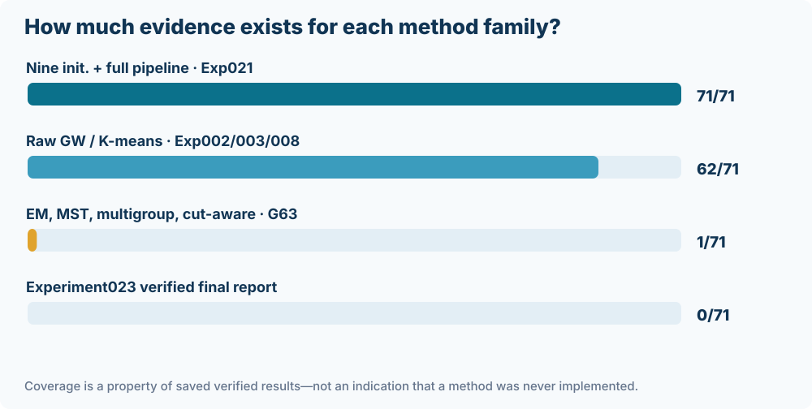

**Three evidence strata** (do not pool):

1. **71 graphs:** nine Experiment021 initialization methods, complete Round → Flip → KL → ILS.
2. **62 graphs:** archived **20-start raw rounding** by GW/FJ, K-Means2N and antipodal K-MeansNM.
3. **G63 only:** MST, soft EM/CEM/Gibbs, multi-group K-means, cut-aware and specialized KL/ILS trials.

**Experiment023:** 17 registered protocols; **no verified complete numerical report** found on its branch at deck preparation.

---

## Historical raw rounding: the antipodal control is strong

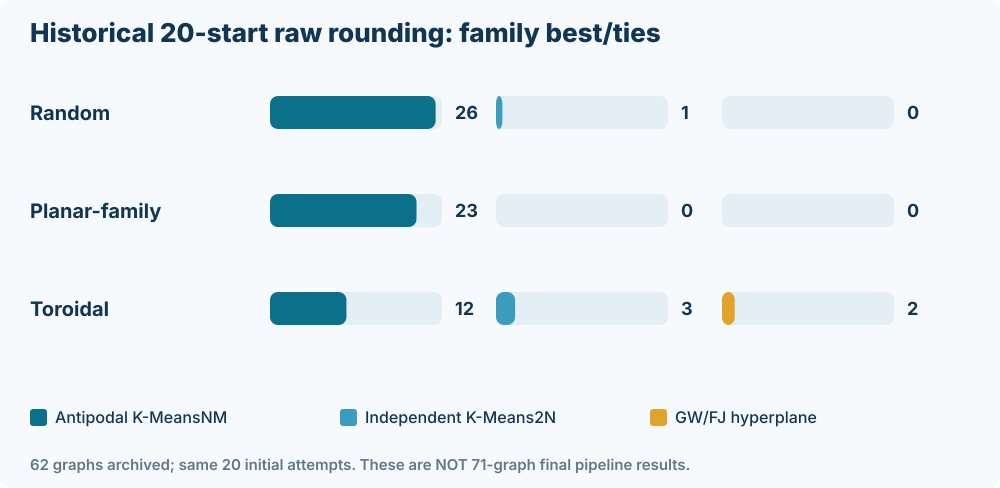

From the archived **62-graph**, **20-start** raw rounding comparison:

- Random: antipodal K-MeansNM wins/ties on **26/27**.
- Planar-family: **23/23**.
- Toroidal: **12/12**.

Overall, it wins or ties on **61/62** graphs among these three algorithms.

**Not the same endpoint:** these are **unrefined** partitions from Exp002/003/008, not the 50-restart Experiment021 finals.

---

## How much did antipodal K-means improve over raw GW?

At the **best-of-20 rounding stage**, unweighted mean within-family relative improvements were:

| Family | Graphs with archived raw results | Mean relative K-MeansNM gain vs GW/FJ |
|---|---:|---:|
| Random | 27 | **+2.032%** |
| Planar-family | 23 | **+1.723%** |
| Toroidal | 12 | **+1.019%** |

These are descriptive, graph-normalized **best-of-20** comparisons, not approximation guarantees or global significance tests.

*Different restart and refinement budgets prevent direct numerical pooling with Experiment021.*

---

## Exact MSTs in the high-dimensional EVA space

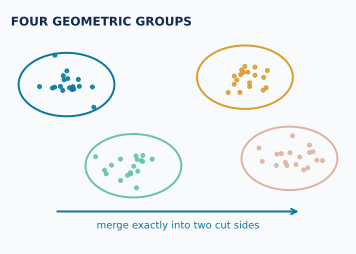

1. Compute an exact MST over **all EVA vectors** in $\mathbb R^p$; metric: L1, L2 or L∞.
2. Remove one edge (**longest**, **balanced**, **diameter center** or **best original cut**) or several edges.
3. Merge components into two **binary** cut sides.
4. Evaluate signed cut and optionally refine original vertices.

**Important:** the MST is built from **vector distances**, not the signed graph weights.

Cost: roughly $O(n^2p)$ for each exact full-space MST; large graphs need explicit feasibility checks.

---

## Why one MST edge is not always enough

For a tree edge $e$, the resulting cut can be written as

$$
C(e)=\sum_{\{i,j\}\in E}w_{ij}\,\mathbf 1[e\in P_T(i,j)],
$$

where $P_T(i,j)$ is the unique path between $i$ and $j$ on the **geometric MST**.

- Longest edge optimizes **distance**, not signed cut.
- **Best-cut edge** explicitly scores all $n-1$ possible one-edge tree splits.
- Multi-edge coarsening optimizes over a contracted **signed** graph.

This suggests a structural hypothesis: **MST performance should depend on how EVA-space geometry aligns with graph-edge frustration**.

---

## Soft EM-like rounding versus hard K-means

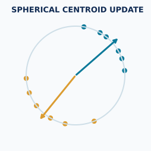

Instead of hard cluster membership, assign $p_i\in[0,1]$ and optimize a **mean-field objective** combining:

- Expected **signed Max-Cut** under independent Bernoulli labels.
- Geometric agreement with EVA centroids.
- Entropy regularization / temperature annealing.

Then generate hard candidates through **thresholding, CEM or Gibbs**, with optional KL refinement.

**Not standard maximum-likelihood EM:** the repository calls this an **EM-like variational alternating** procedure.

---

## The elite-source trap: retaining is not improving

**G63 historical record: 26,917** was already achieved by the Experiment013 K-MeansNM + Flips + KL + ILS pipeline.

Experiment016's **elite-initialized EM/CEM/Gibbs** variants also reported **26,917**.

However, their starting **source partition already achieved 26,917**, and none of those elite episodes improved its source cut.

**Interpretation:** matching the historical record by retaining an elite is **not** evidence that EM independently discovered that solution.

The new Experiment023 protocol deliberately excludes elite warm starts from its primary EM arms.

---

## G63 case study: cross-method scores, different budgets

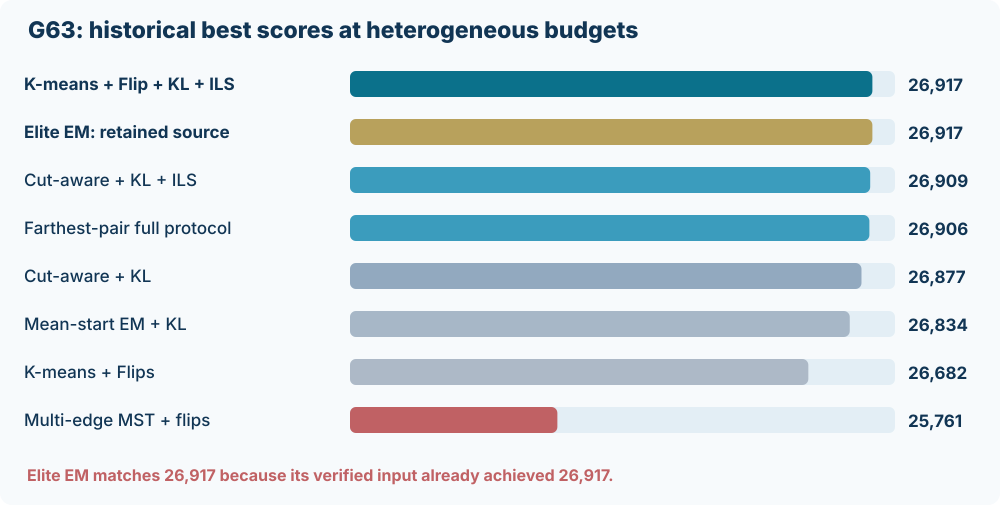

The strongest observed cut remains **26,917** (Experiment013).

- Cut-aware + KL + ILS: **26,909**.
- Farthest-pair full pipeline: **26,906**.
- Mean-start EM + KL: **26,834**.
- Multi-edge MST + vertex flips: **25,761**.

**Do not rank them as if they had equal attempts or identical postprocessing**. The figure is a verified historical **archive comparison**, not a controlled tournament.

---

## Multigroup K-means: clustering $k$ ≠ Max-$k$-Cut


For temporary $k$-way EVA clusters, aggregate original signed graph edges into $W_{ab}$.

Then find the best **binary merge**:

$$
C(z)=\sum_{a<b}W_{ab}\mathbf1[z_a\ne z_b],\quad z_a\in\{0,1\}.
$$

With one merge side fixed to remove complement symmetry, there are $2^{k-1}-1$ nontrivial merges.

At **k=10**, that is **511** distinct nontrivial merges, *conditional on the cluster assignment*. Still only binary Max-Cut.

---

## Historical data cannot settle a topology-wide MST/EM ranking

| Method family | Archived structural coverage | Biggest interpretive issue |
|---|---|---|
| GW/FJ, K-Means2N, K-MeansNM raw | **62** graphs | Different stage than Exp021 |
| Nine initializers + common refinement | **71** graphs | GW screen-16 screening overhead |
| MST, EM, cut-aware, multi-group and advanced search | **G63** chiefly | Different pilots, budgets and stages |
| Direct hyperplane / selected older studies | Historical code/notes | Some consolidated summaries unverified |

**The missing scientific experiment is not another chart.** It is a **new, prospective, consistent benchmark** across graph families.

---

<!-- _class: chapter -->

# 8. Experiment023 — a prospective all-method benchmark

**Registered design · implementation committed · completion not independently verified**

---

## From initializer tournament to a family-wide benchmark

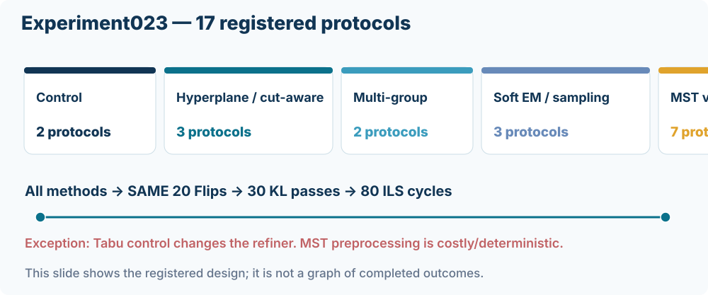

Experiment021 asked: *Which centroid initialization works best?*

Experiment023 asks: **Which whole rounding family yields the strongest cut under a shared refinement policy and bounded computation?**

**17 registered protocols** × **71 original graphs** = **1,207 planned graph-method cells**.

Only **verified completed cells** can later enter an empirical ranking.

---

<!-- _class: compact -->

## The 17 Experiment023 registered protocols

| Rounding / optimization family | Protocols |
|---|---|
| K-means controls | `control-paired`, `control-tabu`* |
| Hyperplane / cut-aware | `gw-threshold`, `cutaware-kmeans`, `hyperplane-sweep` |
| Multi-group EVA clustering | `multigroup-k4`, `multigroup-k8` |
| EM-like and stochastic | `em-hard`, `em-cem`, `em-gibbs` |
| Exact L2 MST | `mst-l2-longest`, `-balanced`, `-diameter`, `-bestcut`, `-multicut` |
| Exact alternative-distance MST | `mst-l1-bestcut`, `mst-linf-bestcut` |

*Tabu changes the **refiner**, not merely an initializer; analyze separately.*

---

## The full-run common downstream pipeline


For **comparable hard binary seeds**, use:

**Round → up to 20 positive flip sweeps → 30 generalized KL passes → 80 ILS cycles** (eight inner KL passes; kicks 8/16/32/64).

**Maximum 100 restarts or a 240-second per-method wall-time budget**, whichever comes first, with hard timeout at 510 seconds.

MST is deterministic per factor and metric; **do not pretend repeated identical trees are independent restarts**.

---

## The fairness protocol: control what is comparable

One graph, one frozen source factor, same original signed cut objective.

Record separately:

1. **Raw** candidate score before refinement.
2. Flip, KL and ILS **final** scores.
3. Factor/graph SHA, preprocessing cost, evaluations and wall time.
4. Warm-start or elite source (if any), seeds and trace.
5. **Timeout**, failure, budget-limited or completed status.

The 240-second target is a **ceiling**, not a mathematically exact equal-work guarantee. MST preprocessing and EM sampling may dominate the cost.

---

## Pilot gate → complete sweep → coverage audit

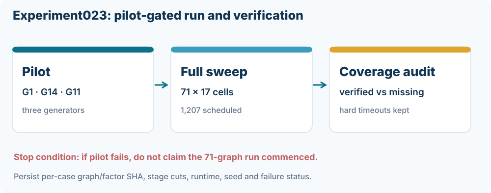

**Pilot graphs:** G1 (random), G14 (planar-family), G11 (toroidal).

- Validate code, factor hashes, feasible cuts and computational costs.
- Full workflow starts **only if every pilot succeeds**.
- One self-hosted Windows runner; checkpoint one graph at a time.
- Audit a **71 × 17 = 1,207-cell** outcome matrix.

**A declared cell is not a completed run.** A timeout must remain visible in the final report.

---

## Historical Experiment023 evidence status (29 October 2026)

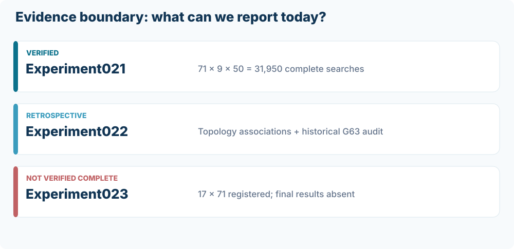
At the earlier 29 October presentation, Experiment023 contained its workflow, methods and protocol but **no verified final coverage/report JSON**.

**Therefore, this presentation gives no invented Experiment023 winner, score, speedup or topology-specific conclusion.**

Link: [Experiment023 protocol](https://github.com/heri-espino/maxkcut/blob/experiment023-all-method-topology/notes/experiments/experiment023-all-method-topology.md).

---

## Earlier registered analysis plan for Experiment023

**Primary question:** within each original graph and a bounded budget, which method returns the best *verified feasible* cut?

A prespecified analysis should include:

- **Within-graph normalized gain** against new paired control.
- Fractional wins with ties split across winning protocols.
- Runtime-quality **Pareto frontier**; shared MST cache cost allocation.
- Separate positive-only and signed-weight graphs.
- Random / planar-family / toroidal **stratification**.
- Leave-generator-family-out validation and graph-level intervals.

Do not pool 1,207 correlated cells as 1,207 independent graph samples.

---

<!-- _class: chapter -->

# 9. What we learned — and what remains open

A scientific story of **reproducible experimentation**, not a single champion score.

---

## The full research trajectory, one view

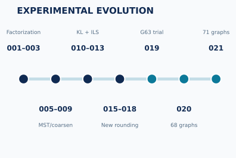

**Early program:** factor construction, GW/K-means, exact MST, KL/Tabu, multigroup and soft EM.

**Experiment021:** 71 verified graphs, 31,950 initializations/refinements.

**Experiment022:** topology and historical-coverage retrospective audit.

**Experiment023:** prospective all-family protocol designed; final run evidence still pending.

---

## Four different questions must stay distinct

| Question | Statistic | Current strongest evidence |
|---|---|---|
| Best *individual* cut? | Best-of-50 | GW screen-16 most best/ties in Exp021 |
| Best *typical* restart? | Graphwise mean final cut | Original paired is competitive; GW +0.059 raw units |
| Best method for a **graph family**? | Family-stratified wins | Descriptive GW toroidal association; not predictive yet |
| Best method *per CPU-second*? | Equal-budget anytime cuts | **Not established** by Exp021/022; Experiment023 proposed |

These distinctions prevent choosing a champion by **changing the evaluation target after seeing results**.

---

## Findings of Experiments021–022 — historical snapshot

**Supported statements:**

- The original graph and final feasible signed Max-Cut are independently verified.
- The G-set Experiment021 study is **complete**: 71 graphs and 31,950 searches.
- GW screen-16 achieved the most best-cut ties/wins, but spent more initial evaluations.
- Graph generator family correlates with some observed method wins.
- The simple topology selector did not beat global selection in held-out comparison.
- Historical MST/EM results cannot justify all-graph ranking without wider runs.

**Not supported:** new SDP optimality certificate, a Max-$k$-Cut ($k>2$) claim, equal-budget superiority, or final Experiment023 winners.

---

## Reproducibility: every claim links to an archive

| Item | Source of truth |
|---|---|
| Canonical signed G-set inputs | `data/G*.txt` |
| Experiment021 complete cuts/restarts | `results/gset/experiment021-.../statistics/` |
| Experiment022 labels/LOOCV/history | `results/gset/experiment022-graph-structure-methods/` |
| Experiment023 registered protocol | `notes/experiments/experiment023-all-method-topology.md` |
| Experimental implementation | `src/maxkcut/` |
| Regenerable vector charts | `presentations/.../build_new_figures.py` |

Retain source factor SHA, graph SHA, verified partition, configuration ID and method-stage timing in all future reports.

---

## Earlier next-step proposal, before Experiment025

**Original prospective checklist (revisited by the now-complete Experiment025 sweep):**

1. Audit complete graph-method **coverage and timeouts**.
2. Re-score every archived cut and validate source-factor identity.
3. Compare **cut vs wall-time** under the same method budget.
4. Measure structural predictors: degree CV, cycles, sign fraction and EVA spectrum.
5. Evaluate structural method selectors on graph families withheld from training.
6. Report effect size, graph-level uncertainty, multiplicity and negative results.

The method × topology hypothesis is revisited with completed Experiment025 best-of-16 results in Chapter 10.

---


<!-- _class: chapter -->

# 10. Experiment025 — completed numerical study

**What changes when we compare 18 methods across 71 graphs and measured graph structure?**

71 graphs × 18 methods × 16 matched GW directions = **20,448 completed refinements**.

---

<!-- _class: compact -->

## New protocol: complete coverage, a different scientific estimand

- **Baseline:** each graph and seed uses the same GW direction; independently refined GW-RR provides the graph-specific reference.
- **Methods:** GW threshold/sweep; paired/cut-aware K-Means; multigroup $k=4,8$; hard/CEM/Gibbs EM; seven MST hybrids; paired + Tabu.
- **Each of 16 starts:** initializer → Flip → KL → ILS. Retain the **best encountered cut**, not only the last candidate.
- **Across 71 graphs:** compare $100[C_{g,m}-C_{g,\mathrm{GW}}]/C_{g,\mathrm{GW}}$ to normalize score scales; each graph receives equal weight.

**Limit:** shared GW directions are not equal CPU budgets. Graphwise best-of-16 summaries are **not** individual seed-level paired differences.

Source: `results/gset/experiment025-gw16-bestcut-quality/analysis/full_best_final_by_graph.csv`.

---

<!-- _class: small -->

## E025 — All 18 methods against refined GW-RR

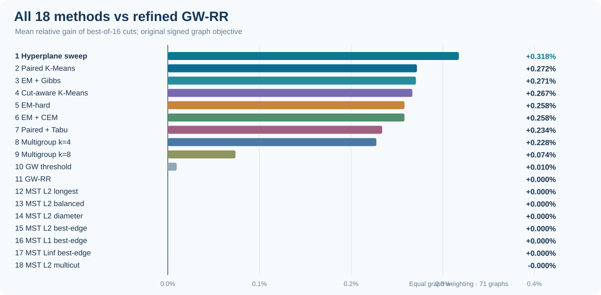

**Descriptive leader:** Hyperplane Sweep, +0.318% mean relative gain in best-of-16 cut quality.

---

<!-- _class: small -->

## E025 — The top methods are close in performance

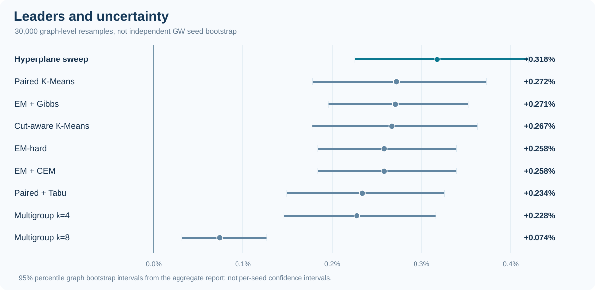

Intervals resample **graphs**, not matching individual GW seeds; no unique champion is established.

---

<!-- _class: small -->

## E025 — Gains depend on generator family

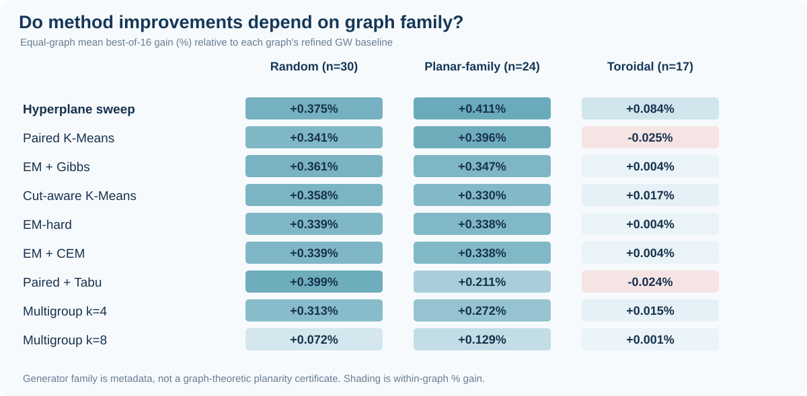

Random (30), planar-family (24), toroidal (17): these are **generator labels**, not planarity certificates.

---

<!-- _class: small -->

## E025 — Edge-weight signs also change the pattern

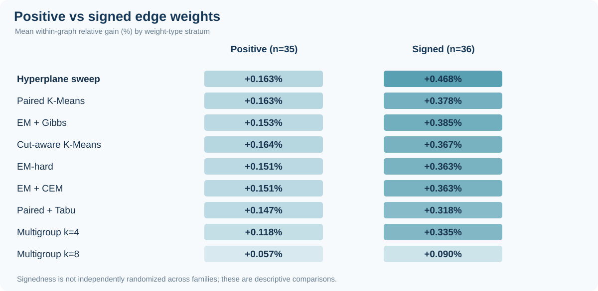

The 35 positive and 36 signed instances are **not independently randomized across families**.

---

<!-- _class: small -->

## E025 — Graph-by-graph: fixed method versus oracle

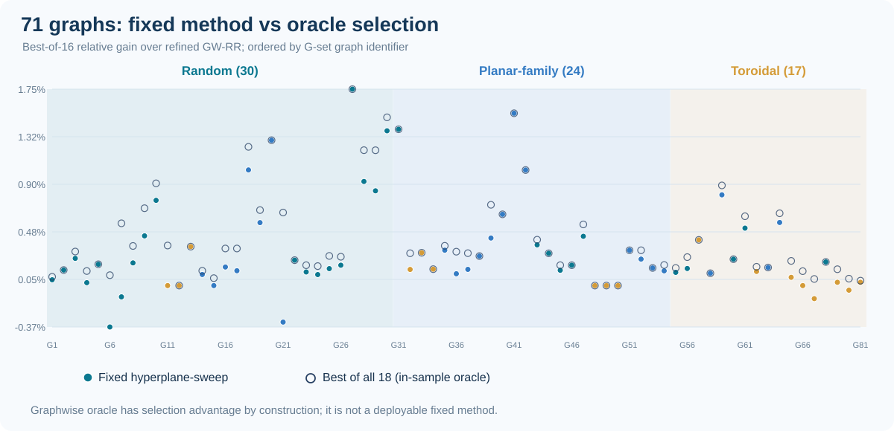

The graphwise best of 18 is chosen **after seeing the outcomes** and is at least as good as GW-RR by construction.

---

<!-- _class: small -->

## E025 — The 71 × 10 quality heatmap

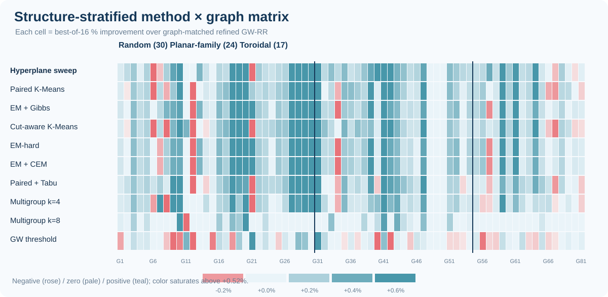

Each tile represents the best-of-16 gain for one method on one graph.

---

<!-- _class: small -->

## E025 — Fractional winner credit respects ties

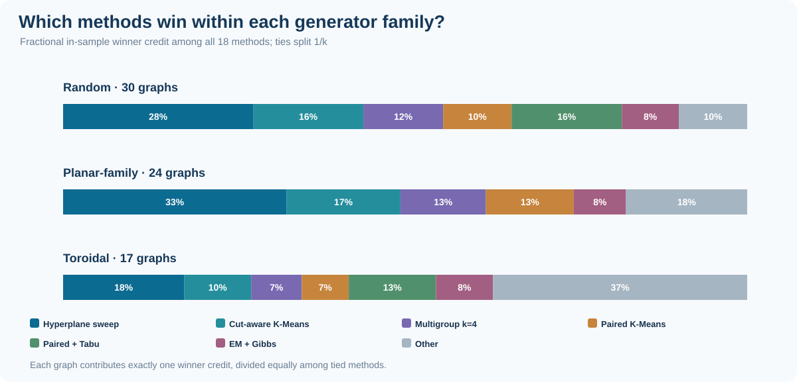

Every graph contributes one unit of credit, divided equally among its tied best methods.

---

<!-- _class: chapter -->

# 11. Which structural properties correlate with improvement?

**Experiment022 measured original-edge topology; Experiment025 measured method quality.**

The canonical graph ID, family and sign type link the two archived datasets.

---

<!-- _class: small -->

## Structural axis A — Average degree

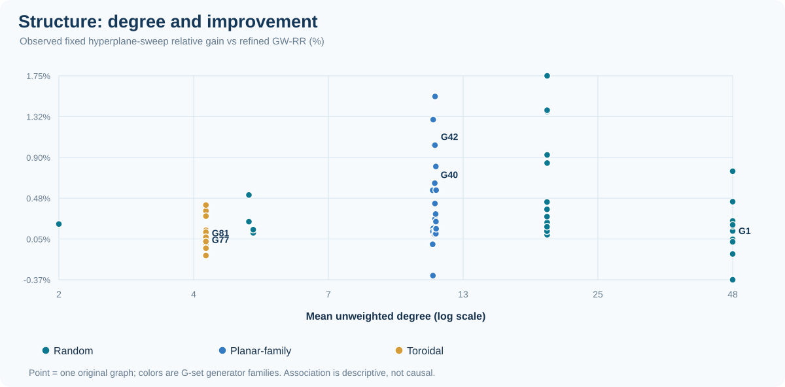

Density is strongly associated with generator design and can confound any cross-family explanation.

---

<!-- _class: small -->

## Structural axis B — Global transitivity

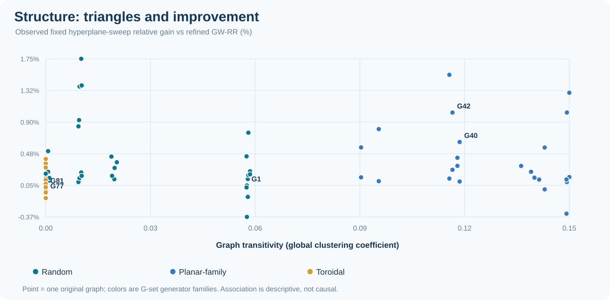

Triangle clustering measures original edges, not positions in an illustrative drawing.

---

<!-- _class: small -->

## Structural axis C — Negative-edge fraction

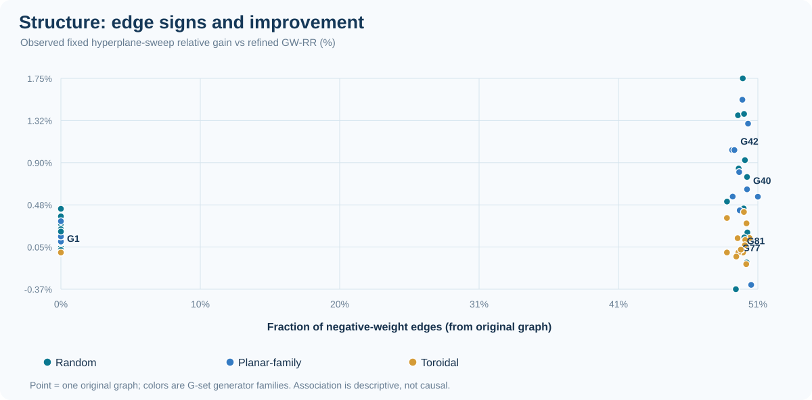

This is an observed association; **do not infer a causal effect of negative weights**.

---

<!-- _class: compact -->

## Three distinct levels of evidence

| Level | Available evidence | Valid conclusion |
|---|---|---|
| **Graph-level census** | 1,278/1,278 complete cells | Descriptive all-graph rankings |
| **Graph topology** | Degree CV, triangles, transitivity, sign fraction, $n,m$ | Observed structure–quality associations |
| **Matched individual seeds** | 20,448 VM-local seed results | Not yet exported/independently audited for paired inference |

The best method *conditional on family* was selected and evaluated on these **same** graphs. It is not a validated selector for unseen graphs.

---

<!-- _class: small -->

## E025 — Best-of-16 versus mean-of-16

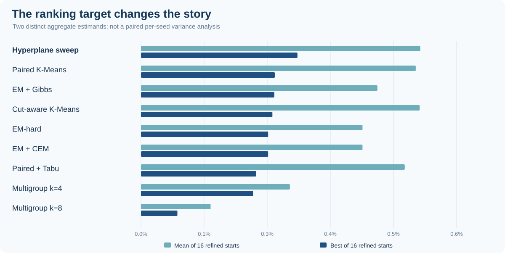

A method may discover an exceptional cut without being best for the typical refined start.

---

<!-- _class: small -->

## E025 — Eight candidate reference improvements

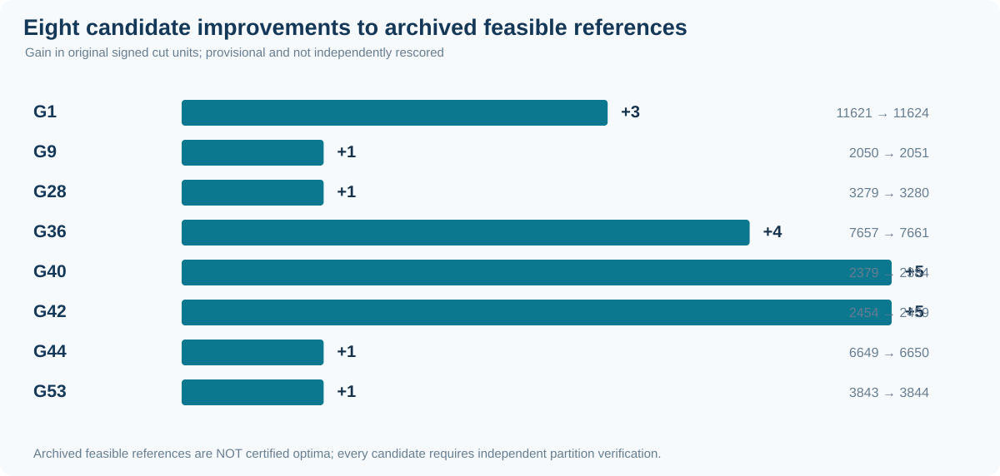

G1, G9, G28, G36, G40, G42, G44 and G53 exceed **archived feasible references** by 1–5 cut units. These are **not independently verified records**.

---

<!-- _class: small -->

## E025 — Reference ratio: random graphs

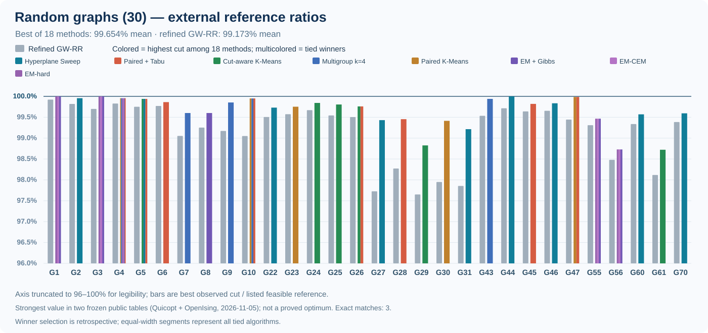

For each graph, **best-of-16 cut / strongest listed external feasible reference**. Gray = refined GW; colored = graphwise best of 18; multi-colored = ties. Not a certified approximation ratio.

---

<!-- _class: small -->

## E025 — Reference ratio: planar-family graphs

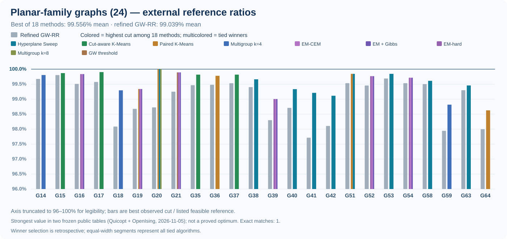

For each graph, **best-of-16 cut / strongest listed external feasible reference**. Gray = refined GW; colored = graphwise best of 18; multi-colored = ties. Not a certified approximation ratio.

---

<!-- _class: small -->

## E025 — Reference ratio: toroidal graphs

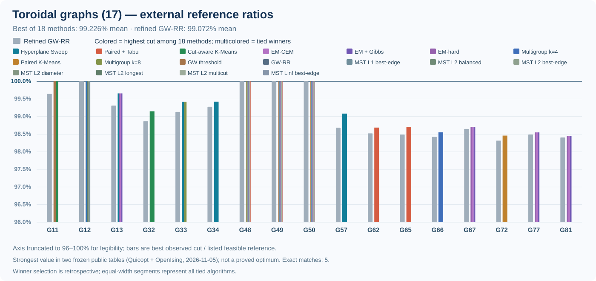

For each graph, **best-of-16 cut / strongest listed external feasible reference**. Gray = refined GW; colored = graphwise best of 18; multi-colored = ties. Not a certified approximation ratio.

---

<!-- _class: compact -->

## E025 — How decisive is the Hyperplane Sweep lead?

| Compared with | Mean relative difference | Graphwise W/T/L | Wilcoxon $p$ |
|---|---:|---:|---:|
| Control Paired | +0.046 percentage points | 36/10/25 | 0.226 |
| EM + Gibbs | +0.047 pp | 36/9/26 | 0.163 |
| Cut-aware K-Means | +0.051 pp | 41/7/23 | 0.110 |
| Refined GW-RR | +0.318 pp | 59/7/5 | $7.7\times10^{-11}$ |

Hyperplane Sweep leads **one fixed metric**, but the closest alternatives are competitive.

These tests pair **71 graph-specific best-of-16 cuts**, not 20,448 independent samples.

---

<!-- _class: compact -->

## E025 — When common local refinement erases differences

Six of the seven MST hybrids reproduce GW-RR's best-of-16 and mean-of-16 aggregates on every graph. The MST multicut arm differs by one unit on G54.

EM-Hard and EM-CEM are likewise equal at the **aggregate** level.

Possible explanations include convergence to similar local optima, method-design overlap or a code issue. **Only per-seed journals, raw candidates and stage partitions can distinguish them.**

Identical aggregates **do not imply identical trajectories**.

---

<!-- _class: chapter -->

# 12. Experiment027 — guided hyperplane search

**New prospective methods on the same saved EVA geometry.** All 71 G-set graphs, 16 paired GW starting normals, 3 angular strategies and **no new SDP solve**.

---

<!-- _class: small -->

## E027 — What changes relative to Experiment025?

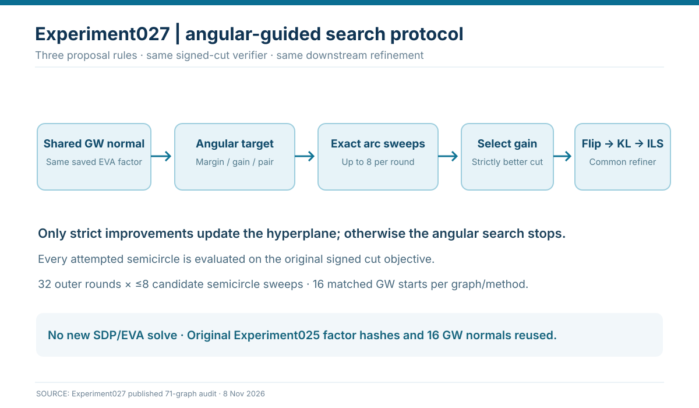

The **initializer** changes, while the signed objective and 20 Flip / 30 KL / 80 ILS-KL full postprocessing protocol remain fixed. Each new method proposes directions for exact one-dimensional arc sweeps.

---

<!-- _class: compact -->

## E027 — Three geometric strategies, one signed cut

With EVA vectors $y_i$ and unit normal $r$, label $x_i=\mathbf 1[y_i^\top r>0]$.

Define angular margin $\delta_i=\arcsin(|y_i^\top r|/\|y_i\|)$, spin $s_i=1-2x_i$, and one-flip gain $g_i=s_i(Ws)_i$.

| New method | How candidate great-circle tangents are chosen |
|---|---|
| **Angular Margin** | Vertices with the smallest $\delta_i$ first |
| **Angular Gain** | Larger $\max(0,g_i)/(\delta_i+10^{-3})$ first |
| **Angular Pair** | Target a pair of top-ranked vertex crossing boundaries |

At each outer round, evaluate up to **8 exact semicircle searches**, accept only a **strict** original-cut improvement, and stop after at most **32** rounds. “Exact” describes each *tested arc*, not the global Max-Cut solution.

---

<!-- _class: compact -->

## E027 — Paired design and independent audit

| Audited unit | Count | Interpretation |
|---|---:|---|
| Canonical signed G-set graphs | **71** | Same original-edge objective |
| New angular methods | **3** | Margin, Gain, Pair |
| Exact matching GW normals per method/graph | **16** | Original Experiment025 directions |
| New angular seed archives | **3,408** | $71\times3\times16$ |
| Historical comparator seed archives rechecked | **2,272** | GW-RR and Hyperplane Sweep only |
| Total audited seed archives | **5,680** | Partition hashes and signed-cut rescoring |

**Reproducibility:** 71 content-addressed GitHub Release ZIPs preserve the new methods' per-candidate events, accepted normals, stage partitions and strictly improving snapshots. These do **not** back up every historical Experiment025 method.

---

<!-- _class: chapter -->

# 13. Experiment027 — results and interpretation

**Question A:** Does angular guidance outperform refined GW? **Yes on average.**

**Question B:** Does it beat existing Hyperplane Sweep? **Not conclusively per method.**

---

<!-- _class: small -->

## E027 — Mean best-of-16 gain over refined GW

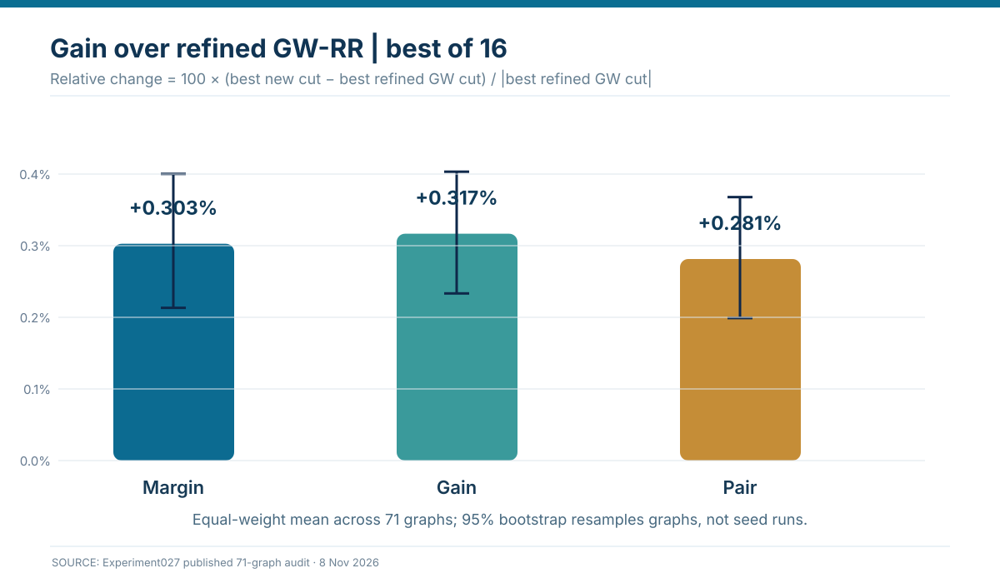

**Angular Gain:** +0.3167%; **Margin:** +0.3027%; **Pair:** +0.2814%. Error bars are **95% graph-bootstrap intervals** (not 3,408 independent seeds).

---

<!-- _class: compact -->

## E027 — Exact graph-level leaderboard

| New method | Mean % gain vs refined GW | 95% graph bootstrap | W/T/L vs GW | W/T/L vs HP |
|---|---:|---:|---:|---:|
| **Angular Gain** | **+0.3167%** | [0.2334%, 0.4033%] | 61 / 8 / 2 | 30 / 10 / 31 |
| Angular Margin | +0.3027% | [0.2132%, 0.4002%] | 56 / 9 / 6 | 29 / 14 / 28 |
| Angular Pair | +0.2814% | [0.1990%, 0.3678%] | 56 / 7 / 8 | 28 / 9 / 34 |

Each row compares **one method's highest refined cut over 16 starts on each graph**. Mean percentages give equal weight to each graph, not each raw cut magnitude.

---

<!-- _class: small -->

## E027 — No single-method dominance over Hyperplane Sweep

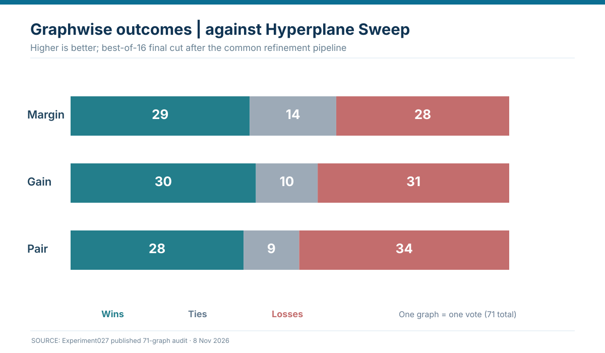

Wins and losses are almost balanced. **Gain** wins 30 graphs, ties 10 and loses 31, despite its positive gain relative to refined GW.

---

<!-- _class: small -->

## E027 — Uncertainty of the comparison with HP

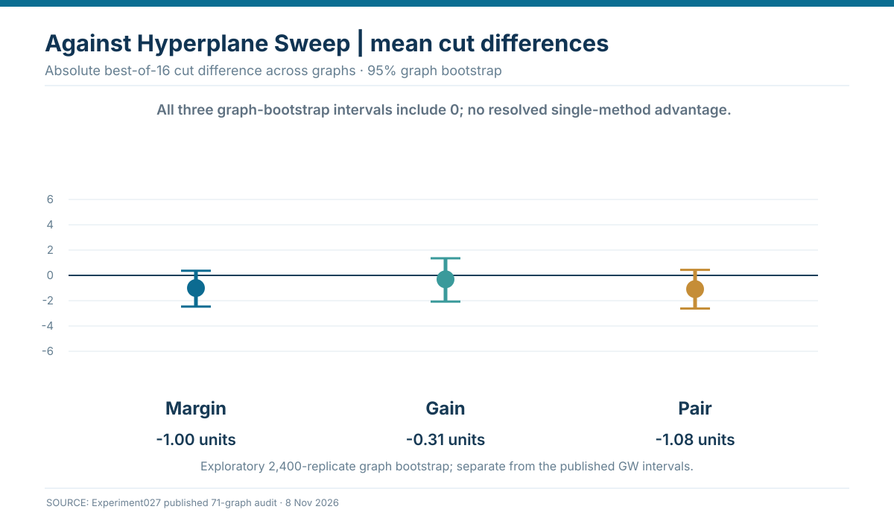

Mean best-of-16 signed-cut differences: Gain **−0.31**, Margin **−1.00**, Pair **−1.08** units. Exploratory 95% graph-bootstrap intervals **include zero**; no equivalence or superiority conclusion follows.

---

<!-- _class: small -->

## E027 — Every graph, all three new methods

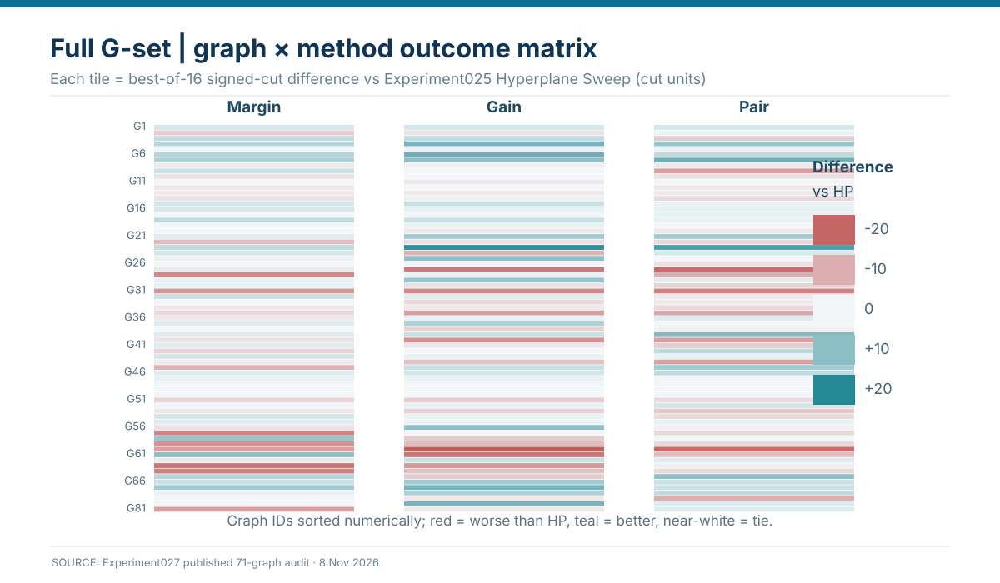

These are 213 graph–method comparisons, not 213 independent graphs. Both positive and negative deviations from Hyperplane Sweep persist.

---

<!-- _class: small -->

## E027 — Raw geometric rounding versus final search

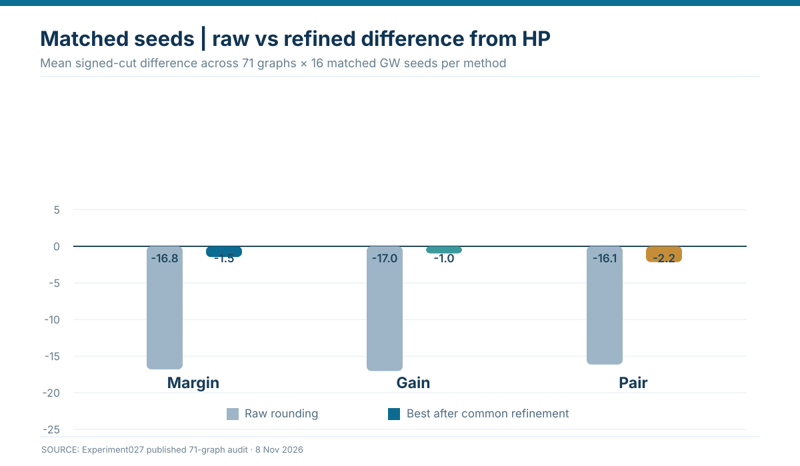

**Per matched seed**, the new angular raw cuts average about **16–17 units below HP raw cuts**, but the common refinement reduces the final differences to approximately **1–2 units**. These are *per-seed* means, not best-of-16 means.

---

<!-- _class: small -->

## E027 — Where the refinement closes the gap

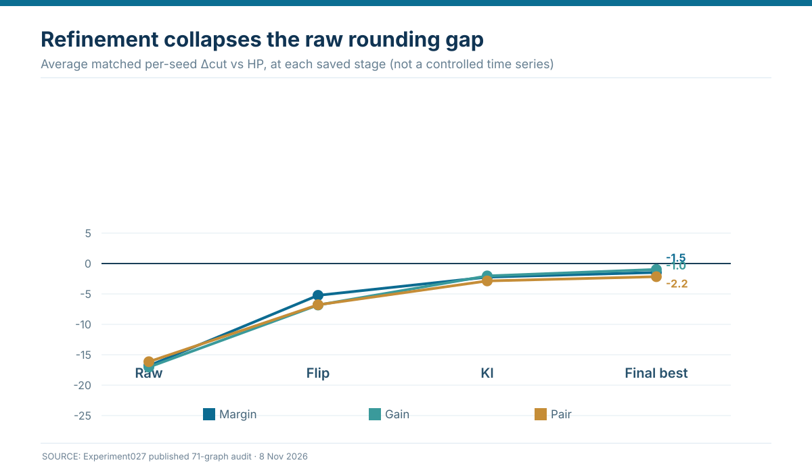

Stage scores are rescored on the **same original signed graph**. Raw, Flip, KL and Final are successive checkpoints—not an equally timed computational trajectory.

---

<!-- _class: small -->

## E027 — Variation across paired starting normals

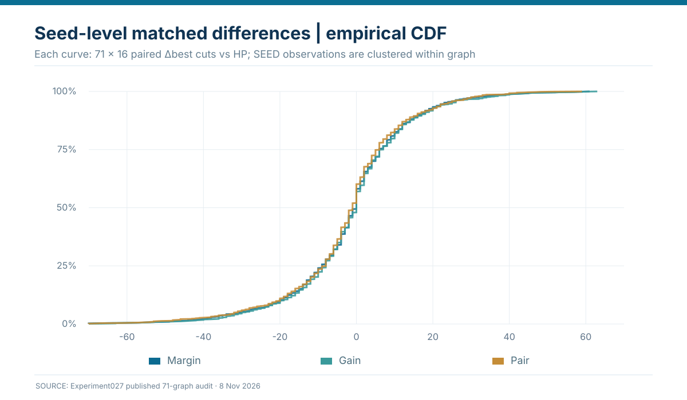

Each curve includes **1,136 matched graph–seed differences** versus HP; within-graph starts are correlated. The empirical distributions help explain why a best-of-16 winner need not have superior average seed quality.

---

<!-- _class: small -->

## E027 — Quality versus recorded computational time

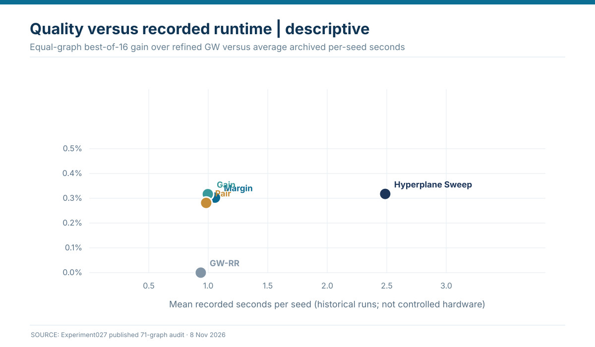

Mean seconds/seed: GW-RR **0.937**, Margin **1.057**, Gain **0.996**, Pair **0.983**, HP **2.487**. Historical timing and unequal candidate budgets make this a **descriptive cost–quality frontier**, not a controlled speedup claim.

---

<!-- _class: small -->

## E027 — Effects vary across G-set generator families

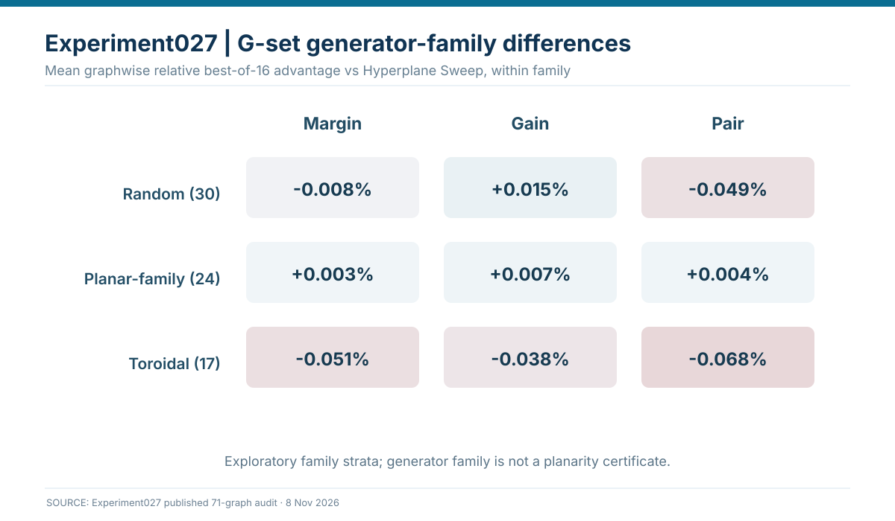

Random, planar-family and toroidal are **generator labels**. Method differences within these groups are descriptive and not a held-out method-selection rule.

---

<!-- _class: small -->

## E027 — Weight sign changes the apparent pattern

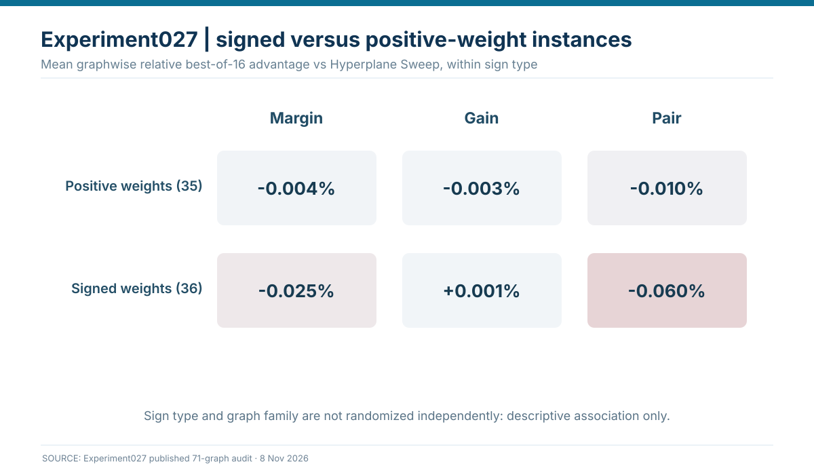

Positive-only and signed-weight G-set subsets differ in structure as well as weights. **No causal claim** about sign effects is justified without matched graph controls.

---

<!-- _class: small -->

## E027 — Combining the three methods: an upper bound on portfolio value

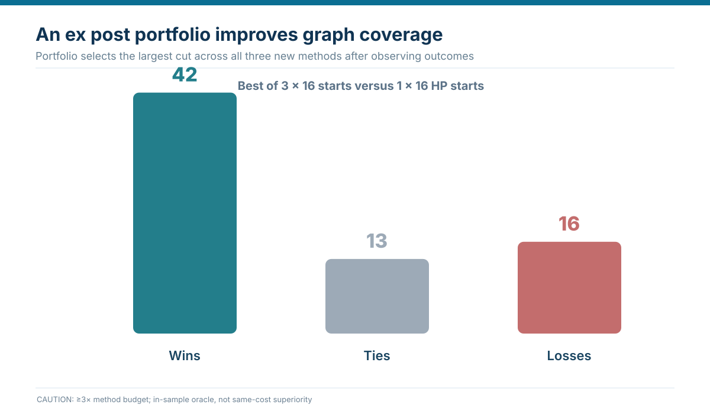

Choosing the **best of three methods for each graph after observing results** beats HP on **42**, ties **13**, loses **16**; average Δcut **+2.76**. This spends multiple method budgets and is **not a fair equal-cost comparison**.

---

<!-- _class: small -->

## E027 — Where the portfolio succeeds and fails

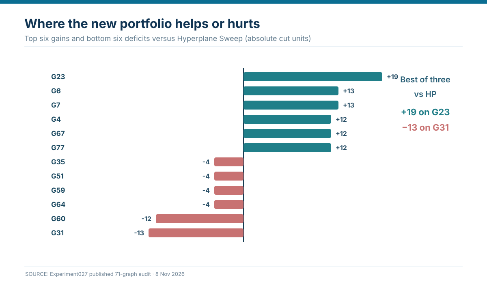

Large positive examples include **G23 (+19)**, G6/G7 (+13); **G31 (−13)** and G60 (−12) still favor historical HP. These are *feasible signed cuts*, not established new global records.

---

<!-- _class: compact -->

## E027 — Research interpretation and next controlled experiment

**Thesis:** Angular search improves refined GW quality on most graphs, and the 3-arm portfolio contains complementary successes.

**Antithesis:** No angular method unambiguously dominates existing HP; raw angular candidates are weaker on average, and historical runtimes are not controlled.

**Synthesis:** Investigate quality per **matched computational budget**, graph-family heterogeneity, and generalization on **held-out graphs**.

1. Compare equal numbers of tested semicircle paths **and** equal CPU budgets.
2. Separate raw geometry from Flip/KL/ILS improvements.
3. Verify independent off-VM ZIP readback; preserve older Experiment025 full raw histories.
4. Treat retrospective winner selection as an **oracle upper bound**, not a learned selector.

---

<!-- _class: compact -->

## E027 — Permanent archive and reproducibility

- [Immutable full 71-graph release](https://github.com/heri-espino/maxkcut/releases/tag/experiment027-data-71g-2b313a624780291eb4dd): **71 ZIP files**, per-graph SHA-256 manifests, per-seed JSONL and NPZ results.
- [Latest-release pointer](https://github.com/heri-espino/maxkcut/blob/experiment027-angular-greedy/published/experiment027/latest_release.json) and **5 published analysis CSV/JSON files**.
- [Experiment027 analysis and results handoff](https://github.com/heri-espino/maxkcut/blob/experiment027-angular-greedy/notes/experiments/experiment027-published-71-graph-results-2026-11-08.md).
- Figure generator: `presentations/build_experiment027_figures.mjs`, based on **audited committed CSVs**, plus Experiment022 original-edge metadata.

**Important boundary:** This audit covers **3 new + 2 historical comparator methods**, not the full 18-method historical raw archive. GitHub verified the Release asset digests; a separate-machine download check remains valuable.

---

<!-- _class: chapter -->

# 14. Scientific conclusions and verification

Completed: **comparative numerical search**. Still required: **independent archive audit**.

---

<!-- _class: compact -->

## Evidence, limitations and next steps

**Supported descriptively:** Experiment027's 3 new arms improve over refined GW in mean best-of-16; none clearly dominates Hyperplane Sweep in a single-method comparison. In Experiment025, Hyperplane Sweep leads the equal-graph relative best-of-16 metric; top competitors are close; family, graph topology and weight signs are associated with performance differences; 71/71 graphs have full 18-method status coverage.

**Not established:** a universally superior method, equal-compute superiority, a held-out topology-driven selector, independently verified public records or certified SDP optima.

**Without rerunning EVA or refinement**, next:

1. Back up the VM-local JSONL/NPZ archive off-VM and verify checksums.
2. Re-score winning partitions independently on original signed edges.
3. Preserve Experiment027's already-published 5,680 audited seed records; separately export/audit the remaining historical Experiment025 raw methods.
4. Test proposed structural policies with genuinely **held-out graph groups**.

Source: Experiment025 completion milestone, the Experiment022 graph-feature audit and the aggregate-only analysis.

---

<!-- _class: chapter -->

# Final synthesis

**Experiment025** completes an 18-method numerical comparison; historical Hyperplane Sweep leads its mean graphwise best-of-16 metric (+0.318% over refined GW). **Experiment027** adds three fully audited angular strategies using identical GW starts and EVA factors: Gain +0.3167%, Margin +0.3027%, Pair +0.2814% versus refined GW; none shows consistent single-method superiority over HP. The post-hoc 3-arm portfolio wins 42/71 graphs against HP but uses a larger search budget. Equal-cost tests and the remaining Experiment025 raw-data backup are still open.

---

<!-- _class: small -->

## Literature and permanent experiment sources

**Research foundations**

- Rodríguez Fernández, Á. E. (2021). *On the Study of Fitness Landscapes and the Max-Cut Problem* (Chs. 6–7).
- Rodríguez-Fernández, Á. E., et al. (2020). *Clustering Improves the Goemans–Williamson Approximation for the Max-Cut Problem*. *Computation* **8**, 75. DOI: [10.3390/computation8030075](https://doi.org/10.3390/computation8030075).
- Felzenszwalb, P., Klivans, C., & Paul, A. (2022). *Clustering with Semidefinite Programming and Fixed Point Iteration*. *JMLR* **23**, 21-0402.

**Primary archived results and design**

- [Experiment021 report — full 71 graphs](https://github.com/heri-espino/maxkcut/blob/main/results/gset/experiment021-complete-71-gset/statistics/report.json).
- [Experiment022 note — topology and historical methods](https://github.com/heri-espino/maxkcut/blob/experiment022-graph-structure-methods/notes/experiments/experiment022-graph-structure-methods.md).
- [Experiment023 note — future outcomes not verified](https://github.com/heri-espino/maxkcut/blob/experiment023-all-method-topology/notes/experiments/experiment023-all-method-topology.md).

**Updated for Professor Ángel E. Rodríguez Fernández · 8 November 2026.**

- [Experiment025 completed local sweep](https://github.com/heri-espino/maxkcut/blob/main/notes/experiments/experiment025-full-local-computation-2026-11-03.md).
- [Experiment025 aggregate analysis](https://github.com/heri-espino/maxkcut/pull/75) (provisional; archive audit pending).
- Graph features: `results/gset/experiment022-graph-structure-methods/graph_features.csv`.
- [Experiment027 published 71-graph Release](https://github.com/heri-espino/maxkcut/releases/tag/experiment027-data-71g-2b313a624780291eb4dd) and [full analysis](https://github.com/heri-espino/maxkcut/blob/experiment027-angular-greedy/published/experiment027/releases/experiment027-data-71g-2b313a624780291eb4dd/analysis/audited_comparison.json).

---

<!-- _class: chapter -->

# Appendix A — Method-name decoder

**What does each strange algorithm name mean?**

An implementation-grounded guide to the **9 Experiment021 initializers**, **18 Experiment025 protocols**, **3 Experiment027 angular methods**, and the shared improvement stages.

The name does **not** necessarily tell us which part of the search changes.

---

<!-- _class: compact -->

## A1. First decode the vocabulary

| Token | Meaning in this repository | How to read it |
|---|---|---|
| **GW** | Goemans–Williamson | A random hyperplane through the origin |
| **FJ** | Frieze–Jerrum label | For $k=2$, the code uses GW's one-hyperplane rule |
| **RR** | Randomized rounding | Sample a direction and separate by its sign |
| **EVA** | Name of saved factor optimizer | All methods reuse its **fixed vertex vectors** |
| **K-Means** | Spherical $k$-means | Group vectors by nearby directions |
| **PCA** | Principal component analysis | Use an axis of strongest embedding variation |
| **MST** | Minimum spanning tree | Connect vectors with minimum total geometric distance |
| **L1 / L2 / L∞** | Manhattan / Euclidean / Chebyshev | Which distance defines the MST |
| **EM / CEM** | EM-like updates / cross-entropy method | Probabilities, then probabilistic cut search |
| **KL / ILS / Tabu** | Kernighan–Lin / iterated local search / tabu search | Post-rounding label modifications |

*“EVA,” “NM,” and “2N” are inherited implementation labels; do not infer an unsupported acronym expansion from the letters.*

---

<!-- _class: compact -->

## A2. Three distinct algorithm stages

| Stage | What changes? | Example | Does the resulting cut stay a hyperplane split? |
|---|---|---|---|
| **Embedding** | Position of every vertex vector $y_i$ | Saved EVA factor | Not a partition yet |
| **Rounding / initialization** | Hyperplane, centroids, groups or probabilities | GW, MST, EM, Angular Gain | **Sometimes** |
| **Graph-based refinement** | Binary vertex labels themselves | Flip, KL, ILS, Tabu | **Not necessarily** |

**Full Experiment025/027 benchmark:** initial partition → retain best GW start → **Flip → KL → ILS** (except Tabu control).

**For the proposed geometry-only study:** stop after **rounding**. Do not let KL/ILS hide which cuts the hyperplane can actually represent.

---

<!-- _class: compact -->

## A3. The early EVA names: three raw rounders

| Archived name | Plain-English name | Actual initial operation |
|---|---|---|
| `FJ_EVA` | Random GW hyperplane on EVA vectors | Sample $r$; cut by $y_i^\top r\geq0$ |
| `K-Means2N_EVA` | Two independently initialized spherical centers | Draw two unrelated random unit directions; run spherical Lloyd updates |
| `K-MeansNM_EVA` | Antipodal spherical two-means | Start centers at $r$ and $-r$; update centroids; retain best observed signed cut |
| `FJ-Flip_EVA` | GW plus vertex flips | Add a positive-gain single-vertex search after raw GW |
| `K-MeansNM-Flip_EVA` | Antipodal K-means plus flips | Add the same flip stage after spherical clustering |

**Important:** the suffix `-Flip` identifies a **second algorithmic stage**, not a different EVA factor. The original `FJ_EVA` name is a legacy repository label; for $k=2$ its code implements GW rather than multiway FJ rounding.

Source: `src/maxkcut/eva_rounding_cli.py`, `src/maxkcut/rounding.py`.

---

<!-- _class: compact -->

## A4. Experiment021 — Nine centroid starts (1–5)

All nine rules initialize **two spherical K-means centers**. Then Lloyd, Flip, KL and ILS run under the same protocol.

| Recorded initializer | What its name means | Actual center choice |
|---|---|---|
| `paired` | Original paired control | Random unit $r$ and its **antipode** $-r$ |
| `independent` | Independent centers | Two unrelated random unit directions |
| `sample-antipodal` | Vertex sample + opposite | Choose an EVA row $y_i$, then $-y_i$ |
| `sample-pair` | Two real embedding samples | Choose two distinct EVA rows |
| `farthest-pair` | A sampled row and its furthest | Choose $y_i$ and the row with smallest dot product to it |

Here **“paired” means antipodal centers**, not the later benchmark's *matched 16 GW seeds*.

Source: `src/maxkcut/eva_kmeans_initializers.py`.

---

<!-- _class: compact -->

## A5. Experiment021 — Nine centroid starts (6–9)

| Recorded initializer | Literal idea | Actual construction |
|---|---|---|
| `spherical-pp` | Spherical K-means++ | First sampled EVA row; second drawn with probability proportional to squared spherical Euclidean distance |
| `mean-perturb` | Perturb the mean direction | Two nearby normalized directions around the embedding mean |
| `pca-antipodal` | PCA axis and its antipode | Leading centered PCA direction + random jitter, then its negative |
| `gw-screen16` | Screen **16 GW hyperplanes** | Score 16 fresh normal vectors; retain the best, then start two antipodal centers |

**Beware two different “16” counts:** `gw-screen16` spends 16 *additional initial scoring trials per restart* in Experiment021. Experiment025's `GW16` refers to **16 shared starting normals per method and graph**.

These nine rules alter **initial centroids**, not the subsequent graph-search algorithm.

---

<!-- _class: compact -->

## A6. Experiment025 — The three control protocols

| Exact method name | Why that name? | What it does |
|---|---|---|
| `gw-rr` | GW randomized rounding | Use the **same original GW hyperplane** and its raw labels |
| `control-paired` | Paired K-MeansNM baseline | Start the two centers at the **same saved** $\pm r$ and run spherical Lloyd |
| `control-tabu` | Paired control with Tabu | **Same initial K-MeansNM** as above, but switch final ILS-KL stage to Tabu-KL |

**Crucial:** `control-tabu` is not a new rounding initializer; it changes the **refiner**. Do not group it with standard-refinement methods for strict equal-postprocessor interpretation.

Every arm has an archived, matched GW direction, but their internal work differs.

---

<!-- _class: compact -->

## A7. Experiment025 — Three hyperplane/cut-aware methods

| Exact name | Translation | How the method searches |
|---|---|---|
| `gw-threshold` | Move the GW plane **parallel to itself** | Sort projections $y_i^\top r$; examine every feasible threshold; use best signed cut |
| `cutaware-kmeans` | Cut-aware spherical K-means | Start GW-aligned Lloyd; propose perturbed/centroid/gain-guided directions; exactly optimize the threshold for each |
| `hyperplane-sweep` | Optimize the hyperplane by angular sweeps | Rotate the normal along candidate great semicircles; exactly find each arc's best cut; keep improvements |

**What “exact” does not mean:** threshold optimization is global **for one fixed direction**, and arc optimization is exact **for one chosen arc**. Neither is an analytical global Max-Cut solver.

Sources: `eva_cutaware_kmeans.py`, `eva_direct_rounding.py`.

---

<!-- _class: compact -->

## A8. Why threshold and rotation are different

**Translate** a hyperplane by changing $b$ while the normal $r$ stays fixed:

$\qquad x_i=\mathbf1[y_i^\top r>b]$.

Only the order of the scalar projections $z_i=y_i^\top r$ matters. There are at most $n+1$ feasible threshold regions (fewer under ties).

**Rotate** it by changing $r$ while $b=0$:

$\qquad r(\theta)=r\cos\theta+u\sin\theta,\quad u^\top r=0.$

The labels change only at crossing angles. Sort the events and score each constant-cut region.

**Experimental consequence:** `gw-threshold` and `hyperplane-sweep` are complementary search strategies, not two spellings of the same algorithm. The new Experiment028 proposal studies combinations **without any KL/ILS correction**.

---

<!-- _class: compact -->

## A9. Experiment025 — Multigroup-K4 and Multigroup-K8

**Names decoded:** `multigroup-k4` = first make **4 clusters**; `multigroup-k8` = first make **8 clusters**.

1. Run spherical $k$-means on the saved EVA vectors, initially using antipodal center pairs.
2. Sum the original signed graph weights between each pair of clusters.
3. Enumerate binary assignments of the $k$ temporary clusters to two cut sides.
4. Keep the highest-scoring **binary merge** encountered during Lloyd iterations.

| Method | Temporary clusters | Nontrivial binary merges per cluster configuration |
|---|---:|---:|
| `multigroup-k4` | 4 | $2^{4-1}-1=7$ |
| `multigroup-k8` | 8 | $2^{8-1}-1=127$ |

**These do not solve Max-4-Cut or Max-8-Cut.** Their final labels are always **binary Max-Cut** labels; (k) counts temporary clusters only.

Source: `eva_multigroup_kmeans.py`.

---

<!-- _class: compact -->

## A10. Experiment025 — The three EM-like methods

**EM = expectation–maximization-like alternation**, here between probabilities and spherical centroids; it is **not** an ordinary fitted Gaussian-mixture model.

| Exact method | Expand the name | What actually happens |
|---|---|---|
| `em-hard` | Hard cut from soft EM-like updates | Alternate Bernoulli membership probabilities and centroids under an entropy-regularized signed-cut objective; harden to labels |
| `em-cem` | EM plus **cross-entropy method** | First run soft EM, then sample binary partitions and refit probabilities toward high-scoring (“elite”) cuts |
| `em-gibbs` | EM plus **Gibbs sampling** | First run soft EM; then use temperature-annealed conditional vertex sampling based on signed flip gains |

Experiment025 starts probabilities near the **same GW partition**; no prior best-known elite is smuggled in. In CEM/Gibbs the intermediate sample can get worse, while the best hard cut is retained.

Source: `eva_soft_em_bernoulli.py`.

---

<!-- _class: compact -->

## A11. What is an `mst-l2-...` name?

Split the method name into three parts:

**`mst` – `l2` – `bestcut`**

| Part | Controls | Does *not* mean |
|---|---|---|
| **mst** | Build a **minimum spanning tree** on every EVA vector | An MST of the *original signed graph* |
| **l1** | Distance $\sum_j|y_{ij}-y_{kj}|$ | The cut objective |
| **l2** | Euclidean distance $\|y_i-y_k\|_2$ | Vertex count |
| **linf** | Maximum coordinate difference | Infinite-dimensional embedding |
| **longest / balanced / diameter / bestcut / multicut** | How to turn the tree into an initial binary cut | A different SDP solution |

**The metric chooses the tree.** Afterwards, candidates are always evaluated on the **original signed graph**, not using tree edge lengths.

Source: `eva_mst.py`, `eva_mst_center.py`.

---

<!-- _class: compact -->

## A12. Five L2-MST variants, decoded

| Exact method | Meaning | What gets split? |
|---|---|---|
| `mst-l2-longest` | Longest geometric tree edge | Remove the **longest** MST edge |
| `mst-l2-balanced` | Most balanced tree split | Remove the edge maximizing $|S|(n-|S|)$ |
| `mst-l2-diameter` | Midpoint of tree diameter | Remove the edge containing the **weighted-diameter midpoint** |
| `mst-l2-bestcut` | Best *signed* cut among tree-edge splits | Evaluate all single-edge tree splits; choose the highest original cut |
| `mst-l2-multicut` | Cut *multiple* tree edges | Remove 1, 4 or 16 long edges; optimize binary assignments of the resulting components |

**“BestCut” means best within the tree-edge candidate family, not globally optimal Max-Cut.** “Balanced” optimizes sizes, not the original graph objective.

---

<!-- _class: compact -->

## A13. The remaining MST variants and an important caveat

| Exact method | What changes from `mst-l2-bestcut`? |
|---|---|
| `mst-l1-bestcut` | Compute the geometric MST using **Manhattan distance**; then select the original-score-best tree-edge split |
| `mst-linf-bestcut` | Compute the geometric MST using **maximum-coordinate/Chebyshev distance**; then make that same best-cut selection |

**How Multicut actually works:** removing $q\in\{1,4,16\}$ long MST edges makes $q+1$ components. It searches binary component assignments using original signed aggregate edges. These **component flips are internal to its rounding construction**.

**Experiment025 caveat:** MST branches are explicitly **GW-anchored hybrids**. A deterministic tree does not produce 16 independent trees; the same GW starting candidate is retained whenever it scores better than the MST-derived candidate.

Source: `experiment024_paired_gw16.py`, `eva_mst_multicut.py`.

---

<!-- _class: compact -->

## A14. Experiment027 — Three angular greedy additions

All three **move a hyperplane in the saved EVA space**, test up to 8 exact semicircle candidates per round, and accept the best **strict** signed-cut improvement.

| Exact method | Name meaning | Which candidate boundary to prioritize? |
|---|---|---|
| `angular-margin-greedy` | Closest-angle-first | Vertices with smallest angular distance to the current hyperplane |
| `angular-gain-greedy` | Flip-benefit per angle | Largest nonnegative graph flip gain divided by angular margin $+10^{-3}$ |
| `angular-pair-greedy` | Target two boundaries jointly | Pairs of high-priority vertices; propose a tangent toward their two crossing constraints |

**“Greedy”** = accept the best **immediately realized** improvement, then repeat; stop when no tested candidate improves. Max **32 rounds** per start. No claim of global hyperplane optimality.

Source: `scripts/experiment027_angular.py`.

---

<!-- _class: compact -->

## A15. Angular score, margin, and the word “pair”

For current spin labels $s_i=1-2x_i$, graph weight matrix $W$, and normal $r$:

- **Margin:** $\delta_i=\arcsin\!\bigl(|y_i^\top r|/\|y_i\|\bigr)$.
- **One-vertex flip gain:** $g_i=s_i(Ws)_i$.
- **Gain-to-margin ranking:** $q_i=\max(0,g_i)/(\delta_i+10^{-3})$.

**Margin** prioritizes the next easy geometric crossing. **Gain** combines that cost with the original graph's incentive to change the vertex's side. **Pair** proposes a direction that targets two hyperplane crossing constraints.

Every proposal is still validated by the **exact signed-cut sweep**. A promising single flip or pair is not accepted just because its local gain is positive: its intended labels may not be individually realizable by the chosen hyperplane movement.

The Experiment027 official results then apply the **same Flip/KL/ILS refinement** as Experiment025.

---

<!-- _class: compact -->

## A16. The four improvement-stage names

These are **not initial rounding methods**. They operate on an already binary partition.

| Name | Full name / mnemonic | How it searches the cut |
|---|---|---|
| **Flip** | Positive-gain vertex flips | Move one vertex when its original signed-cut change is positive |
| **KL** | Kernighan–Lin-style | Lock a sequence of vertices according to signed gains; retain the best **cumulative prefix** |
| **ILS-KL** | Iterated local search + KL | Perturb the current cut, run KL again, explore/retain the best over cycles |
| **Tabu-KL** | Tabu search + KL | Temporarily forbid recently visited moves, diversify, and apply KL |

The common E025/E027 pipeline is **Round → Flip → KL → ILS-KL**. The `control-tabu` arm uses **Tabu-KL in place of ILS-KL**.

Sources: `eva_elite_search.py`, `experiment023_methods.py`, `experiment025_journal.py`.

---

<!-- _class: compact -->

## A17. Read result tables without mixing endpoints

| Label in figures | Definition | Can it prove “the hyperplane works”? |
|---|---|---|
| **Raw / Round** | Partition after the named rounding strategy, with retained GW candidate in the paired benchmark | **Yes**, provided the retention rule is declared |
| **Flip** | Raw partition after positive vertex-flip search | **No**: labels need not be hyperplane-separable |
| **KL** | After cumulative-gain Kernighan–Lin optimization | **No** |
| **Final / Best** | Best recorded cut over the full ILS/Tabu refinement trajectory | **No** |
| **Best-of-16** | Highest score from 16 paired starts on the same graph | Reports a search budget, **not** one typical start |

**Important:** method comparisons must use the *same stage*. In the new pure-hyperplane proposal, **only raw realized cuts qualify for the primary endpoint**.

Repeated 16 starts are correlated within a graph; use graphs for uncertainty analysis.

---

<!-- _class: compact -->

## A18. Which existing methods belong in a pure-hyperplane study?

| Method | What it tells us | Admit to the geometric-only comparison? |
|---|---|---|
| `gw-rr` | Baseline random origin hyperplane | **Yes** |
| `gw-threshold` | Best translation at one fixed normal | **Yes** |
| `hyperplane-sweep` | Angular rotation with exact arc evaluation | **Yes, raw only** |
| `angular-margin/gain/pair-greedy` | Three guided rotation heuristics | **Yes, raw only** |
| `cutaware-kmeans` | Directions from centroids and objective-aware perturbations; affine threshold | **Yes, raw hyperplane candidates only** |
| `multigroup-k4/k8`, MST, EM, `control-tabu` | Non-hyperplane combinatorial/probabilistic partition construction or later refinement | **Separate controls**, not pure separator moves |
| **Flip / KL / ILS / Tabu** | Direct label-space correction | **No** |

Never infer global optimality from an exact search along a **single line or arc**. No Experiment028 data have been generated.

---

<!-- _class: small -->

## A19. The full name-to-code reference

**Every Experiment025 name (18):**

`gw-rr`, `control-paired`, `gw-threshold`, `cutaware-kmeans`, `hyperplane-sweep`, `multigroup-k4`, `multigroup-k8`, `em-hard`, `em-cem`, `em-gibbs`, `mst-l2-longest`, `mst-l2-balanced`, `mst-l2-diameter`, `mst-l2-bestcut`, `mst-l2-multicut`, `mst-l1-bestcut`, `mst-linf-bestcut`, `control-tabu`.

**Every Experiment027 name (3):**

`angular-margin-greedy`, `angular-gain-greedy`, `angular-pair-greedy`.

**Every Experiment021 initializer name (9):**

`paired`, `independent`, `sample-antipodal`, `sample-pair`, `farthest-pair`, `spherical-pp`, `mean-perturb`, `pca-antipodal`, `gw-screen16`.

**Implementation provenance:** `eva_kmeans_initializers.py`, `eva_rounding_cli.py`, `experiment024_paired_gw16.py`, `experiment023_methods.py`, `eva_mst_center.py`, `eva_mst_multicut.py`, `eva_multigroup_kmeans.py`, `eva_soft_em_bernoulli.py`, `eva_direct_rounding.py`, `scripts/experiment027_angular.py`.

*This appendix explains the **implemented** algorithms and naming conventions, not inferred acronyms or extra performance claims.*
