<!-- _class: cover -->

# From Random Hyperplanes to 71-Graph Evidence

### A reproducible Max-Cut research program

**SDP-inspired vector factors · spherical clustering · local search · G-set**

Experiments 001–021 · 29 October 2026

Repository: [heri-espino/maxkcut](https://github.com/heri-espino/maxkcut)

Prepared for Professor **Ángel E. Rodríguez Fernández**

---

## Final outcome at a glance

| Scope | Verified result |
|---|---:|
| Canonical G-set graphs | **71 / 71** |
| Initialization families | **9** |
| Matched restarts per graph and method | **50** |
| Fully archived Max-Cut searches | **31,950** |
| Missing factors / incomplete graphs | **0 / 0** |
| Graphs where best-of-nine beats best-of-control | **58 / 71** |

**Important:** these are feasible **binary Max-Cut** results, **not** certified global optima or a general Max-\(k\)-Cut result for \(k>2\).

Source: [Experiment021 report](https://github.com/heri-espino/maxkcut/blob/experiment021-complete-71-gset/results/gset/experiment021-complete-71-gset/statistics/report.json).

---

## Research map: seven linked stages

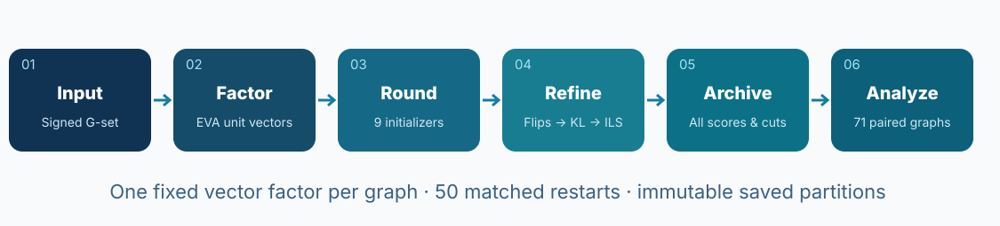

One graph, one immutable vector factor, multiple comparable rounding strategies, exact re-scoring and archived outputs.

---

<!-- _class: chapter -->

# 1. What problem did we solve?

From a discrete graph partition to a geometric representation.

---

## Formal objective: signed Max-Cut

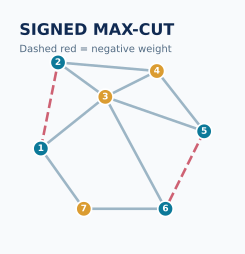

For an undirected graph \(G=(V,E,w)\), choose binary labels \(c_i\in\{0,1\}\):

\[
\max_{c\in\{0,1\}^{|V|}} C(c),\qquad
C(c)=\sum_{\{i,j\}\in E}w_{ij}\,\mathbf 1[c_i\ne c_j].
\]

- **Positive** \(w_{ij}\): rewards placing endpoints on opposite sides.
- **Negative** \(w_{ij}\): penalizes separating the endpoints.
- All reported cut scores use the **original signed weights**.

The clustering objective is **not** the cut objective: it proposes a partition that must subsequently be evaluated on the graph.

---

## Classical SDP relaxation (the theoretical reference)

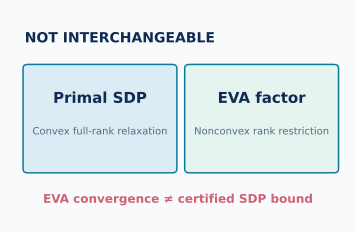

Let \(L=D-W\) and \(X=VV^\top\) be a Gram matrix. For general \(k\ge2\):

\[
\max_{X\succeq0,\,X_{ii}=1}\frac{k-1}{2k}\operatorname{Tr}(LX),
\qquad X_{ij}\ge-\frac{1}{k-1}\quad(k>2).
\]

At \(k=2\), the pairwise lower bound is redundant. Factorization represents each vertex \(i\) by a unit vector \(v_i\).

**Crucial distinction:** the large-scale campaign used **rank-restricted nonconvex EVA factors**; these are not proven solutions or certified bounds for the full convex SDP.

Source: repository `AGENTS.md`, `RESEARCH_HANDOFF.md` and Rodríguez Fernández (2021, Chapters 6–7).

---

## Goemans–Williamson: random hyperplane rounding

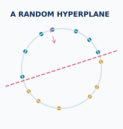

Draw \(r\sim N(0,I_p)\) and set

\[
c_i=\mathbf 1[v_i^\top r<0].
\]

The hyperplane \(v^\top r=0\) separates embedded vertices into two sides.

**The starting question:** why choose an arbitrary hyperplane if the vector embedding already contains structure from an optimization problem?

- Replace the initial two-way split with **spherical clustering**.
- Keep the original graph cut as the evaluation metric.
- Preserve the GW-equivalent starting cut in the original K-MeansNM control.

Source: Rodríguez-Fernández et al. (2020), Sections 1–3.

---

## How spherical K-means enters Max-Cut rounding

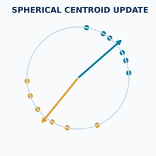

**Original K-MeansNM** initializes two unit centroids as \(u\) and \(-u\). Its first assignment is the GW hyperplane partition.

Then alternate:

1. Assign each \(v_i\) to the centroid with maximum dot product.
2. Normalize each cluster's mean to update its centroid.
3. Keep the **best original-graph cut observed along the trajectory**.

Geometric distortion can decrease without the cut increasing at every step. This is why evaluating **intermediate** iterates matters.

Source: Rodríguez-Fernández et al. (2020), Eq. (4), Lemma 1 and Section 3.1.

---

## Three foundations from the literature

| Work | What it contributed to our design |
|---|---|
| Rodríguez Fernández (2021), thesis | Max-Cut / Max-\(k\)-Cut, SDP geometry, fitness landscapes, clustering rounding |
| Rodríguez-Fernández et al. (2020) | K-MeansNM, K-Means2N and comparison with GW on G-set |
| Felzenszwalb, Klivans & Paul (2022) | Convex geometry of the \(k\)-way elliptope and iterative fixed-point rounding |

The 2022 fixed-point method is **related prior art**, not a claimed component of our Experiment021 implementation.

Sources: project PDFs and [research handoff](https://github.com/heri-espino/maxkcut/blob/experiment021-complete-71-gset/RESEARCH_HANDOFF.md).

---

<!-- _class: chapter -->

# 2. How the research evolved

Prototypes, failed hypotheses, stronger refiners and a controlled comparison.

---

<!-- _class: compact -->

## Experimental chronology: from groundwork to a stable pipeline

| Experiments | Research direction | What we learned |
|---|---|---|
| 001–003 | I/O, full SDP tests, EVA vector factors and checkpoints | Separate exact graph scoring from numerical factor optimization |
| 005–009 | MST partitions, balanced cuts, forest coarsening | Geometry-only bipartitions can be too restrictive |
| 010–013 | Generalized KL, Tabu, cut-aware rounding, pipeline grid, ILS | Post-rounding search is essential; historic G63 best **26,917** |
| 015–016 | Direct hyperplane optimization; soft Bernoulli / entropy approaches | Alternative searches did not replace the strongest pipeline |
| 017–018 | Multi-group clustering, exact binary merging; nine initializers | Fix the downstream pipeline and test initialization systematically |
| 019–021 | Matched G63 experiment, 68-graph expansion, 71-graph completion | Produce a complete auditable statistical dataset |

**Numbering note:** unlisted experiment IDs are not asserted to be completed.

Source: `RESEARCH_HANDOFF.md` and the individual experiment notes.

---

## Step 1 — Build a verifiable experimental substrate

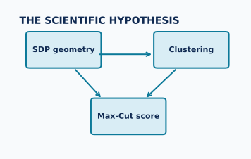

- Keep canonical G-set text graphs, signed weighted edge lists and hashes.
- Implement numerical scoring separately from factor generation.
- Compare the small full-convex SDP pathway with scalable EVA approaches.
- Save reusable factors, iteration histories, seeds and binary partitions.
- Protect large jobs with explicit hardware/resource guards.

**Why:** we needed to distinguish a better *rounded cut* from a different embedding, input graph or solver approximation.

Repo: `src/maxkcut/{objective.py,sdp.py,eva.py,archive.py}`; Experiments001–003.

---

## Step 2 — Obtain geometry with EVA


EVA optimizes a **rank-restricted vector relaxation** over row-unit embeddings \(Y\in\mathbb R^{n\times p}\), with \(Y_i\) representing vertex \(i\).

For the three final missing instances:

\[
p=\lceil\sqrt{2(n+1)}\rceil=119\quad\text{for }n=7000.
\]

- Sequential Numba updates; one BLAS thread.
- Maximum 10,000 sweeps; angular tolerance **0.001 radians**.
- Seed **2026**; checkpoints every **25** sweeps.
- **No claim** of full-SDP convergence or global optimality.

Source: Experiment021 note and `.github/workflows/experiment021-complete-gset.yml`.

---

## Step 3 — Test alternatives to naive rounding

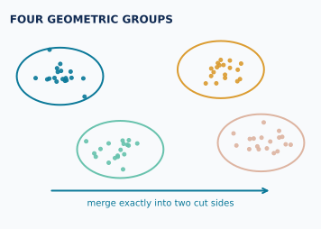

**MST approaches (005–009):** full-dimensional Euclidean / other distances; tree-edge removals, multicomponent contractions, binary regrouping and vertex refinement.

**Reason for moving on:** rigid geometric clusters could miss good signed-graph cuts; G63's one-edge MST result was far below the later K-MeansNM + refinement baseline.

**Critical invariant:** when \(q\) MST edges are removed, the \(q+1\) components are subsequently assigned back to **two** Max-Cut sides, not treated as \(q+1\)-Cut solutions.

Source: Experiment005 and Experiment009 notes.

---

## Step 4 — Improve a cut with exact vertex gains

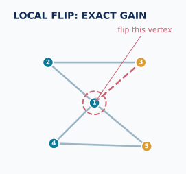

Represent side labels by spins \(s_i\in\{-1,+1\}\):

\[
C(s)=\frac12\sum_{\{i,j\}\in E} w_{ij}(1-s_is_j),
\qquad
\Delta_i=s_i\sum_{j:\{i,j\}\in E}w_{ij}s_j.
\]

Here \(\Delta_i\) is the **exact change in cut** produced by flipping vertex \(i\).

- **Flips:** accept positive-gain moves until locally stable or out of sweeps.
- Use the original signed sparse graph; update neighboring gains efficiently.
- Retain and independently rescore the resulting feasible partition.

Source: Experiment010 note, `src/maxkcut/` local-search implementation.

---

## Step 5 — Escape the one-flip local optimum

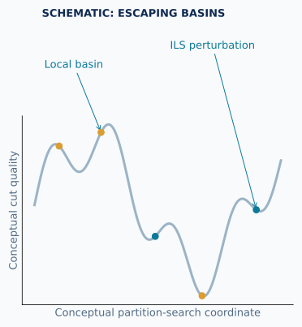

**Generalized KL** (not classical balanced pair-swapping):

1. In one pass, repeatedly choose the highest-gain unlocked vertex.
2. Permit temporarily negative gains.
3. Remember the best **strictly positive cumulative prefix**.
4. Accept that prefix; repeat up to the pass budget.

**Iterated Local Search (ILS):** perturb an elite partition, run inner KL, retain the best feasible cut visited.

This explains why the final score can be much stronger than the initial spherical clustering score.

Source: Experiments010 and 013; see [Experiment019 pipeline](https://github.com/heri-espino/maxkcut/blob/experiment021-complete-71-gset/notes/experiments/experiment019-kmeans-init-full-pipeline.md).

---

## Step 6 — Select the full refinement pipeline (Experiment013)

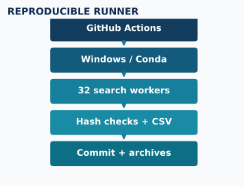

```text
Frozen EVA vector factor
       ↓
Round with candidate method
       ↓
Positive-gain vertex flips
       ↓
Generalized signed KL
       ↓
KL-based iterated local search
       ↓
Final feasible signed Max-Cut + archived partition
```

The historically best verified **G63 feasible cut was 26,917**. The exploratory **27,047** target remained 130 higher and was **not** a proven optimum.

Source: `configs/experiment013-grid.json`, Experiment013 note.

---

<!-- _class: compact -->

## Step 7 — Explore other models, but preserve the main baseline

| Experiment | Hypothesis tested | Methodological distinction |
|---|---|---|
| 015 | A better rounding normal may be found directly | Exact great-semicircle event sweeps; stochastic smoothed-gradient ascent |
| 016 | Soft partition distributions may escape hard-rounding limitations | Entropy-regularized Bernoulli assignments, CEM/Gibbs proposals |
| 017 | More than two clusters may reveal useful latent structure | 2/4/6/8/10 groups, **exact** merge back to binary cuts |
| 018 | Initialization of two centers may be the main lever | Nine systematic initializer families |

For Experiment017, \(q\) geometric groups can be merged to two labels by enumerating \(2^{q-1}-1\) nontrivial complements; at \(q=10\), **511** mergers.

These experiments motivate **controlled initialization comparisons**, not a claim that every exploratory strategy improved the G63 record.

---

<!-- _class: chapter -->

# 3. The frozen comparison protocol

Nine initializers, one embedding per graph, identical downstream budgets.

---

<!-- _class: compact -->

## The nine initialization methods: part I

| Name | How the initial centroids were selected |
|---|---|
| **Original paired K-MeansNM** | Random unit vector \(u\) and antipode \(-u\) |
| **Independent centers** | Two independently drawn random unit directions |
| **Sample antipodal** | An actual embedding row \(Y_i\) and \(-Y_i\) |
| **Sample pair** | Two different randomly chosen embedding rows |
| **Farthest pair** | One sampled row and a row maximally distant by cosine |

All methods operate on the same graph-specific, **fixed EVA factor**.

Source: Experiment018 note and Experiment021 methodology.

---

<!-- _class: compact -->

## The nine initialization methods: part II

| Name | How the initial centroids were selected |
|---|---|
| **Spherical K-means++** | First sampled row; second selected by distance-squared weighting |
| **Mean perturbation** | Two perturbations around the normalized embedding mean |
| **PCA antipodal** | Leading centered principal direction + jitter, then antipode |
| **GW screen-16** | Evaluate 16 random candidate hyperplanes and choose the best |

**Budget warning:** GW screen-16 uses **16 additional graph-cut evaluations** per restart, and PCA has preprocessing costs. Equal restarts does **not** mean equal compute.

Source: Experiment018 note.

---

## Identical downstream refinement for every method

| Stage | Frozen setting |
|---|---|
| Spherical Lloyd | \(k=2\), up to **100** iterations; keep best actual cut |
| Positive vertex flips | Up to **20** sweeps |
| Generalized KL | Up to **30** passes |
| KL-based ILS | **80** cycles; **8** inner KL passes |
| ILS perturbation sizes | **8, 16, 32, 64** vertices |
| ILS temperature | **12** |
| Restarts | **50** per graph and method |

All scores are recorded at **Round → Flip → KL → Final**.

Source: Experiments019–021.

---

## Reproducible RNG design: matched downstream seeds

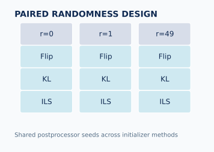

Graph index \(g\), restart \(r\in\{0,\ldots,49\}\), seed base **2026**:

```python
# Two-center rounding initialization
SeedSequence([2026, g, 2, r, 0])  # paired control
SeedSequence([2026, g, 2, r, 1])  # alternative methods

# Same postprocessing streams across methods, for matched r
flips_seed = [2026, g, r, 1313]
kl_seed    = [2026, g, r, 101]
ils_seed   = [2026, g, r, 1401]
```

Matched restart IDs control the **postprocessor randomness**, not the actual random initial centers drawn by different methods.

Source: Experiment019 and Experiment021 notes.

---

## Experiment019 — Controlled pilot on G63

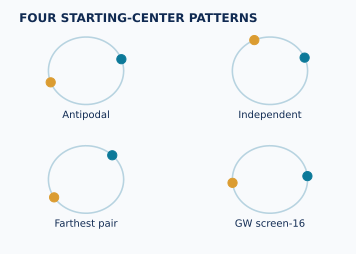

- Original G63 graph: **7,000 vertices**; fixed EVA factor with **119 columns**.
- **9 × 50 = 450** matched, full four-stage searches.
- Best new Experiment019 cut: **26,906** (farthest pair).
- Historical verified feasible record: **26,917** (Experiment013).
- Exploratory target: **27,047**, not a certified optimum.

**Interpretation:** the initializer pilot did not improve the historical G63 record, but gave a well-controlled design suitable for all G-set graphs.

Source: Experiment019 note; `RESEARCH_HANDOFF.md`.

---

<!-- _class: chapter -->

# 4. From one graph to all 71

Windows self-hosted GitHub Actions, resumability and exact coverage checks.

---

## Experiment020 — Expand to the 68 graphs with saved factors

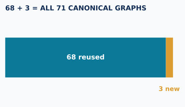

**Goal:** reuse already completed EVA embeddings; do not rerun the expensive factor solves.

- **68** eligible graphs with verified factors: **67 new** + reused G63.
- **68 × 9 × 50 = 30,600** archived full searches.
- **G60, G61, G62** initially excluded because matching completed factors were missing.
- **32** parallel Windows worker processes for rounding/refinement.

A failed first workflow exposed a Windows worker race while writing JSON summaries. Recovery moved per-graph publication **after worker completion** and reused intact saved graph chunks.

Sources: [Experiment020 report](https://github.com/heri-espino/maxkcut/blob/experiment021-complete-71-gset/notes/experiments/experiment020-all-gset-paired-inits.md), [recovery run](https://github.com/heri-espino/maxkcut/actions/runs/40826652014).

---

## Why the self-hosted runner mattered


```text
GitHub Actions dispatch / dedicated research branch
                ↓
Windows 11 runner + maxkcut Conda Python
                ↓
Factor/hash checks + fast regression tests
                ↓
32 independent search workers; resumable chunks
                ↓
Post-join aggregation and exact archive verification
                ↓
Commit + push to experiment branch; upload artifact
```

**Runner usage did not itself guarantee correct data**: input hashes, process synchronization, restart completeness, seed identity and independent rescore checks were all required.

---

## Experiment021 — Generate exactly the missing EVA factors

| Graph | Vertices | Edges | EVA sweeps | Recorded state |
|---|---:|---:|---:|---|
| **G60** | 7,000 | 17,148 | 239 | converged |
| **G61** | 7,000 | 17,148 | 235 | converged |
| **G62** | 7,000 | 14,000 | 571 | converged |

Only these three new nonconvex factors were generated. Original Experiment019/020 factor files and search results remained unchanged.

**Then:** 3 × 9 × 50 = **1,350** new Round→Flip→KL→ILS searches.

Source: [Experiment021 note](https://github.com/heri-espino/maxkcut/blob/experiment021-complete-71-gset/notes/experiments/experiment021-complete-71-gset.md).

---

## Final completeness proof is a machine-checked ledger


\[
\underbrace{68\times9\times50}_{30{,}600\text{ reused}}
+\underbrace{3\times9\times50}_{1{,}350\text{ new}}
=\boxed{31{,}950}.
\]

The consolidated report requires:

- Exactly **71** canonical graph identities.
- Exactly **nine** methods and **50** restart IDs per graph.
- **Zero** missing factors and **zero** incomplete instances.
- Original graph and factor **SHA-256** identities intact.
- Complete saved scores, partition files and per-restart traces.

Passed: [GitHub Actions #40831249367](https://github.com/heri-espino/maxkcut/actions/runs/40831249367).

---

<!-- _class: chapter -->

# 5. Results and interpretation

Distinguishing best individual cuts from average performance.

---

<!-- _class: small -->

## Ranking A — Who reached the best cut on most graphs?

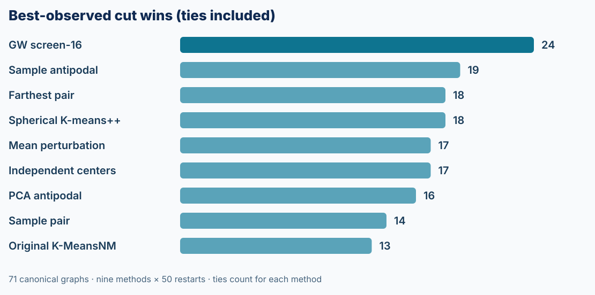

**Best-cut ties count for all tied methods.** Values are graph counts out of 71; they need not sum to 71.

Source: `statistics/per_instance_methods.csv`, recomputed from `best_final`.

---

<!-- _class: compact -->

## Ranking B — Share credit when several methods tie

| Rank | Initialization | Graphs best (incl. ties) | Sole best | Fractional wins |
|---:|---|---:|---:|---:|
| 1 | **GW screen-16** | **24** | **7** | **12.19** |
| 2 | Farthest pair | 18 | **7** | 9.46 |
| 3 | Sample antipodal | 19 | 5 | 8.75 |
| 4 | Mean perturbation | 17 | 6 | 8.50 |
| 5 | Independent centers | 17 | 4 | 7.21 |
| 6 | Sample pair | 14 | 4 | 6.82 |
| 7 | Spherical K-means++ | 18 | 2 | 6.25 |
| 8 | Original K-MeansNM | 13 | 4 | 5.92 |
| 9 | PCA antipodal | 16 | 3 | 5.91 |

Fractional win = \(1/t_g\) for each best-scoring method on graph \(g\), where \(t_g\) is the number tied for best. The fractional wins sum to **71**.

---

<!-- _class: compact -->

## Ranking C — Average final-cut difference versus control

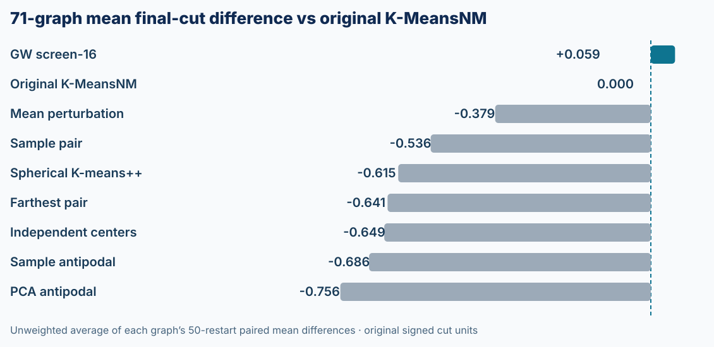

**Method:** calculate each graph's 50-restart mean difference relative to original K-MeansNM; then average the **71 graph-level differences** equally. Positive is better.

Most alternatives are slightly below the control. GW screen-16 is **+0.059 raw cut units**, with extra evaluations and no established statistical dominance.

---

## Three newly completed instances: best observed cuts

| Graph | Best initializer | Best of nine | Control best | Gain |
|---|---|---:|---:|---:|
| **G60** | Sample antipodal | **14,124** | 14,103 | **+21** |
| **G61** | Independent centers | **5,721** | 5,718 | **+3** |
| **G62** | Mean perturbation | **4,816** | 4,808 | **+8** |

All values are **feasible signed Max-Cut scores**, not certificates of optimality.

Source: Experiment021 finalized per-graph records.

---

## Important graph-specific landmarks

**G63**

- Historical best observed feasible cut: **26,917** (Experiment013).
- Experiment019's nine-initializer best: **26,906**.
- Distance from historical record to exploratory **27,047** target: **130**.

**G11**

- A search attained **564** on the canonical instance, matching the repo's cited established optimum for that weighted graph.

Do not transfer historical targets, cut scales or certified-optimum labels between different graph identities.

Sources: `RESEARCH_HANDOFF.md`, Experiment019 note, `docs/gset-reference-values.md`.

---

## Why 58/71 is not an equal-budget victory

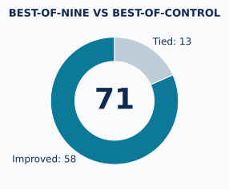

The best of nine methods beat the best of 50 control restarts on **58 graphs** and tied on **13**.

But it had up to **450 searches per graph**, versus **50** for the original K-MeansNM alone.

**A portfolio containing the control can never score worse in best-of-search, by construction.** Its 58 victories are empirical evidence of *diversity and opportunity*, not proof that an individual method is more effective per unit computation.

Also, GW screen-16 considers 16 additional initial hyperplanes per restart.

---

## What the statistics do—and do not—show


**Paired comparison** at graph \(g\):

\[
\Delta_{g,m}=\frac1{50}\sum_{r=0}^{49}
\left[C^{\rm final}_{g,m,r}-C^{\rm final}_{g,\rm control,r}\right].
\]

- Report the mean of the **71** graph-level \(\Delta_{g,m}\) values.
- Within graph, **4,000-replicate paired bootstrap** intervals examine restart variability.
- Do **not** treat 31,950 correlated restarts as independent graphs.
- Do **not** equate a best-of-50 score with expected performance.
- No universal approximation ratio follows from these cut scores.

Source: Experiment021 note; `paired_vs_original_kmeansnm.csv`.

---

<!-- _class: chapter -->

# 6. Reproduction and next steps

What to verify, where the evidence lives, and what remains open.

---

## Repo-first evidence trail

| Path in `maxkcut` | Role |
|---|---|
| `data/G*.txt` | Canonical 71 weighted graph inputs |
| `src/maxkcut/` | Factor, rounding, refiners, aggregation code |
| `results/gset/experiment019-.../` | Historical G63 full-run records |
| `results/gset/experiment020-.../` | 67 additional graphs + analysis |
| `results/gset/experiment021-.../` | G60–G62 factors, cases, archives, full 71-graph statistics |
| `notes/experiments/` | Why/how/what happened/what next |
| `AGENTS.md`, `RESEARCH_HANDOFF.md` | Reproducible AI-agent handoff |

The **GitHub branch**, not the runner's ephemeral scratch space, holds the research record.

---

## Exact verification without repeating the expensive searches

From the populated Experiment021 branch, in Windows PowerShell:

```powershell
python -m pytest tests/test_eva_full_gset_completion.py tests/test_eva_kmeans_init_all.py tests/test_eva_kmeans_init_full.py -q
python -m maxkcut.eva_full_gset_completion_cli inventory
python -m maxkcut.eva_full_gset_completion_cli aggregate
Get-Content "results/gset/experiment021-complete-71-gset/statistics/report.json"
```

The aggregator raises an error if a factor, graph, method or restart is missing, or if the total is different from **31,950**.

**Do not rerun completed EVA/rounding just to regenerate the report.**

---

## Experimental limitations


1. EVA is **rank-restricted and nonconvex**; factor convergence is not an SDP certificate.
2. The study concerns **Max-Cut \(k=2\)**, not a full sweep over \(k>2\).
3. Raw cut magnitudes differ by graph; report within-graph comparisons.
4. GW screen-16 and PCA do not have equal initialization overhead.
5. Best-of-nine portfolios have larger budgets and exploit selection.
6. Bootstrap intervals across starts do not establish graph-universal inference.
7. G63's **27,047** remains an exploratory target rather than a verified optimum.

---

## Experiment022 — The next testable question

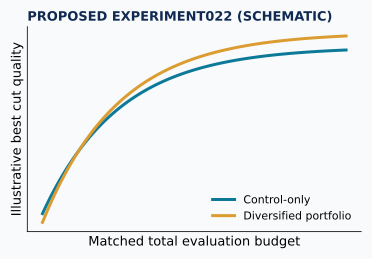

**Hypothesis:** a *diversified* initializer portfolio can exceed repeated K-MeansNM when total computational costs are fixed.

Pre-register before the next run:

- Same graph-specific EVA factor, signed weights and refinement protocol.
- Equal **wall-time and initial-cut evaluation budgets** per graph.
- Compare control-only, GW screen-16, and mixed-method portfolios.
- Evaluate graph-normalized improvement, best-of-budget and stability.
- Use paired graph-level statistics, multiple-comparison corrections and held-out design choices.
- Commit experiment022 scripts, seeds, figures, raw rows and notes separately.

This is a **proposal**, not an experiment already completed.

---

<!-- _class: chapter -->

# Final synthesis

**Structure-aware initialization diversified the solutions we found; the original antipodal K-MeansNM remains a strong baseline.**

We now have a verified, reproducible **71-graph / 31,950-search** dataset to test algorithmic efficiency—not just record cuts.

---

<!-- _class: small -->

## Primary sources and research record

**Literature**

- Rodríguez Fernández, A. E. (2021). *On the Study of Fitness Landscapes and the Max-Cut Problem*. Dissertation, Chapters 6–7.
- Rodríguez-Fernández, A. E., et al. (2020). *Clustering Improves the Goemans–Williamson Approximation for the Max-Cut Problem*. **Computation 8**, 75. DOI: [10.3390/computation8030075](https://doi.org/10.3390/computation8030075).
- Felzenszwalb, P., Klivans, C., & Paul, A. (2022). *Clustering with Semidefinite Programming and Fixed Point Iteration*. **JMLR 23**, article 21-0402.

**Repository records**

- [Research handoff](https://github.com/heri-espino/maxkcut/blob/experiment021-complete-71-gset/RESEARCH_HANDOFF.md)
- [Experiment019](https://github.com/heri-espino/maxkcut/blob/experiment021-complete-71-gset/notes/experiments/experiment019-kmeans-init-full-pipeline.md) · [Experiment020](https://github.com/heri-espino/maxkcut/blob/experiment021-complete-71-gset/notes/experiments/experiment020-all-gset-paired-inits.md) · [Experiment021](https://github.com/heri-espino/maxkcut/blob/experiment021-complete-71-gset/notes/experiments/experiment021-complete-71-gset.md)
- [Machine-readable statistics](https://github.com/heri-espino/maxkcut/blob/experiment021-complete-71-gset/results/gset/experiment021-complete-71-gset/statistics/per_instance_methods.csv)

**Research status at preparation:** Experiment021 was complete on 29 October 2026; see the repository's current main branch for PR merge status.